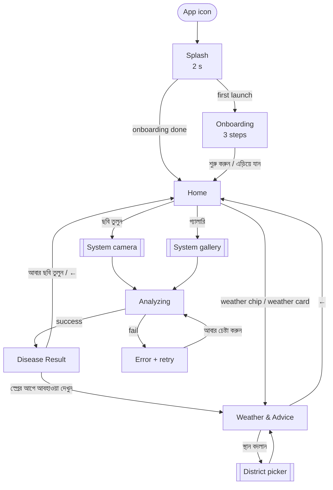
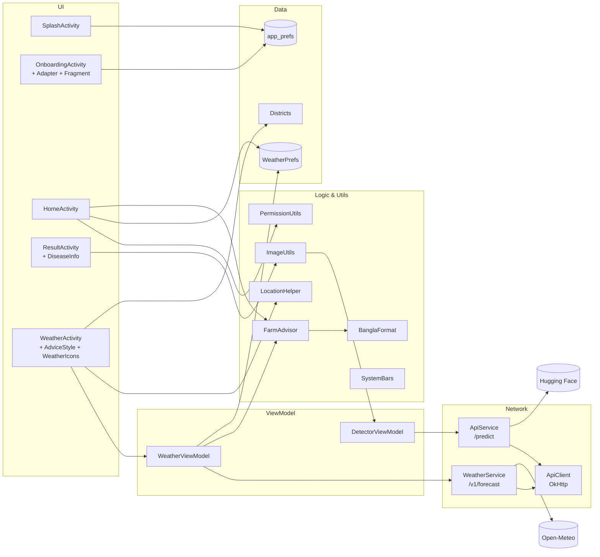
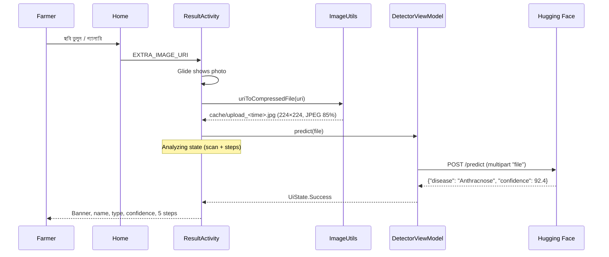

# 🥭 আমের রোগ নির্ণয় — Mango Disease Detector

### Complete App Documentation: all features, screen by screen (v2 design)

| Item | Detail |
|------|--------|
| App name | আমের রোগ নির্ণয় (Mango Disease Detector) |
| Package | `com.example.mango_disease_detector` |
| Platform | Android, Kotlin, XML views + ViewBinding |
| Min / Target SDK | 24 (Android 7.0) / 36 |
| Architecture | MVVM (Activity → ViewModel → Service) |
| Language | Bengali (বাংলা) UI, Bengali voice |
| Target users | Mango farmers in Bangladesh, including low-literacy users |
| Disease AI | Hugging Face Space (`rakibmist-mango-disease-detector.hf.space`) |
| Weather | Open-Meteo API (free, no key) |
| Design source | Design canvas "আমের রোগ নির্ণয় — App Screens" (6 artboards, 390 px wide) |

---

## 📑 Contents

1. [Feature overview](#-feature-overview)
2. [Design system](#-design-system)
3. [App navigation map](#-app-navigation-map)
4. [Architecture](#-architecture)
5. [Screens](#-screens)
   - [1. Splash](#screen-1--splash)
   - [2. Onboarding](#screen-2--onboarding)
   - [3. Home](#screen-3--home)
   - [4. Analyzing](#screen-4--analyzing)
   - [5. Disease Result](#screen-5--disease-result)
   - [6. Weather & Advice](#screen-6--weather--advice)
6. [Feature deep-dives](#-feature-deep-dives)
7. [Data & storage](#-data--storage)
8. [External APIs](#-external-apis)
9. [Permissions](#-permissions)
10. [Project structure](#-project-structure)
11. [Build, run & test](#-build-run--test)
12. [Known limitations & next steps](#-known-limitations--next-steps)

---

## ✨ Feature overview

| # | Feature | What the farmer gets | Where |
|---|---------|----------------------|-------|
| 1 | **Splash** | Branded mango logo screen | `SplashActivity` |
| 2 | **Onboarding** | 3-step illustrated intro (first launch only) | `OnboardingActivity` |
| 3 | **Take photo** | Camera capture of a mango leaf | `HomeActivity` |
| 4 | **Pick from gallery** | Choose an existing leaf photo | `HomeActivity` |
| 5 | **Analyzing** | Animated scan and a progress checklist while the AI works | `ResultActivity` (loading state) |
| 6 | **AI disease detection** | Disease name (8 classes), type, confidence bar | `ResultActivity` → HF API |
| 7 | **Treatment advice** | 5 numbered steps, each with an icon tile | `ResultActivity` + `DiseaseInfo` |
| 8 | **Voice read-out** | 🔊 Speaks the result, advice and weather in Bengali | Result, Weather |
| 9 | **Weather forecast** | Current weather + 7-day forecast for their district | `WeatherActivity` → Open-Meteo |
| 10 | **Farming advice** | Labelled cards: বিপদ / সাবধান / ভালো খবর / মৌসুমি কাজ | `FarmAdvisor` |
| 11 | **Home weather summary** | Weather chip, today's conditions, urgent-advice count | `HomeActivity` |
| 12 | **Location** | Auto GPS → nearest district, or pick from 64 districts | `LocationHelper`, `Districts` |
| 13 | **Offline weather** | Last forecast shown when there's no internet (≤ 3 days old) | `WeatherPrefs` |

---

## 🎨 Design system

The look comes from the design canvas: warm cream background, deep green brand, mango-yellow primary action, sky-blue weather. It aims to feel friendly and rural rather than "tech".

### Principles

| Principle | How it is applied |
|-----------|-------------------|
| **Big & tappable** | Main buttons 70–90 dp tall; icon tiles 44–64 dp; all targets ≥ 44 dp |
| **Minimal reading** | Every action has an icon; colour + label carry the meaning; voice reads the text aloud |
| **Bengali first** | Bengali fonts, Bengali digits (২৫°), Bengali day names and greetings |
| **Physical buttons** | Primary buttons are raised "3D" buttons that press down when tapped |
| **One look everywhere** | Same fonts, radii, colours and icon style on all 6 screens |
| **Light only** | The app ignores system dark mode, so it always looks as designed |

### Typography

Both fonts are bundled in `res/font/` (they work offline). Licences: `assets/licenses/*-OFL.txt`.

| Role | Font | Weight | Where |
|------|------|--------|-------|
| Display | **Baloo Da 2** (`@font/baloo_extrabold`) | 800 | Big titles, temperature, disease name, step numbers |
| Heading | **Baloo Da 2** (`@font/baloo_bold`) | 700 | Screen titles, button labels, card titles |
| Body | **Hind Siliguri** (`@font/hind`) | 400 / 500 / 600 / 700 | All other text (app-wide default) |

| Style (`values/themes.xml`) | Use |
|-----------------------------|-----|
| `Text.Display` | Baloo 800, ink colour, no font padding |
| `Text.Heading` | Baloo 700, ink colour, no font padding |
| `Text.Body` | Hind 500, 1.2 line spacing |
| `Button3D.Green` | Raised green button container |

Typical sizes: splash title 44 sp · screen title 22 sp · big temperature 76 sp · disease name 32 sp · buttons 21–25 sp · body 16–20 sp · labels 13–15 sp.

### Colour tokens (`values/colors.xml`)

| Group | Token | Hex | Use |
|-------|-------|-----|-----|
| **Green** | `green_primary` | `#1F7A3A` | Brand, primary buttons, headers |
| | `green_deep` | `#0F4D24` | 3D button shadow |
| | `leaf` | `#3FA34D` | Leaf icons, healthy confidence bar |
| | `mint` | `#E7F5E9` | Light green tiles |
| | `mint_strong` / `mint_text` | `#BFE6C5` / `#D4EFD9` | Healthy advice header / text on green |
| | `photo_bg` | `#2F6B3A` | Behind the leaf photo |
| **Cream & ink** | `background` | `#FFF8EC` | Screen background |
| | `text_primary` (ink) | `#2B2118` | Main text, dark tiles |
| | `ink_soft` | `#4A3B2C` | Secondary text |
| | `text_secondary` | `#6B5A45` | Muted text |
| | `beige` | `#F1E6D2` | Dividers, day-card border, progress track |
| | `beige_dot` / `sand_pill` | `#E3D3B4` / `#FCEBCB` | Inactive dots / step pill |
| **Mango** | `mango` | `#FFB627` | Camera button, advice header, active step |
| | `mango_deep` | `#D98A00` | Mango button shadow |
| | `sun` / `cream_yellow` | `#FFD166` / `#FFE7A8` | Sun disc, badges / greeting text, today card |
| | `orange` | `#F47C20` | Confidence bar, sun icon strokes |
| | `butter` / `peach` | `#FFF0CC` / `#FFE3D3` | Icon tiles |
| **Sky** | `sky` | `#1E6BB8` | Weather card, forecast title |
| | `sky_light` / `sky_text` | `#E3F0FC` / `#D6E8FA` | Info tiles / text on blue |
| | `sky_deep` | `#154F8A` | Text on light blue |
| **Red** | `red` / `red_deep` | `#C62828` / `#B71C1C` | Disease banner / disease name, max temp |

Advice cards use five colours per level (icon, bg, label, title, body). They are listed under [Weather & farming advice](#d-weather--farming-advice).

### Shapes & components (`res/drawable/`)

| Component | Drawable | Notes |
|-----------|----------|-------|
| Raised green button | `bg_btn3d_green` | 20 dp radius, 6 dp `green_deep` shadow; drops 4 dp on press |
| Raised mango button | `bg_btn3d_mango` | 22 dp radius, 6 dp `mango_deep` shadow |
| Raised round speaker | `bg_circle3d_green` | Oval, 4 dp shadow |
| Outline button | `bg_btn_outline_green`, `bg_btn_outline_sky` | White fill, 2.5 dp stroke, mint when pressed |
| Outline pill | `bg_pill_outline_green` | "স্থান বদলান" |
| Rounded fills | `bg_r14` … `bg_r30`, `bg_pill`, `bg_circle` | White shapes, coloured with `backgroundTint` |
| Home header | `bg_header_home` | Green, 36 dp bottom corners |
| Forecast day | `bg_day`, `bg_day_today` | White + beige border / cream-yellow + mango border |
| Analyzing | `bg_scan_glow`, `bg_step_active`, `bg_step_pending` | Scan line, mango dot with ring, dashed circle |
| Confidence bar | `bg_progress_confidence` | Beige track, orange fill (green when healthy) |
| Splash logo | `bg_logo_ring` | Cream circle with a sun-coloured glow ring |
| Onboarding frame | `bg_dashed_frame` | Orange dashed "camera frame" |

Cards that must clip their contents (photo, result, advice, weather) use `MaterialCardView` with radius 28–30 dp and no stroke.

### Icons

There are no emoji in the UI. Every icon is a vector drawable redrawn from the design's SVGs.

| Set | Files | Style |
|-----|-------|-------|
| **Line icons** | `ic_pin`, `ic_sun_line`, `ic_camera_line`, `ic_gallery_line`, `ic_leaf_line`, `ic_zoom_line`, `ic_chevron_left/right`, `ic_speaker`, `ic_check`, `ic_info_line`, `ic_warning_line`, `ic_clock_line`, `ic_sprout_line`, `ic_drop_line`, `ic_rain_line`, `ic_wind_line`, `ic_cloud_line`, `ic_scissors`, `ic_fire`, `ic_spray`, `ic_calendar`, `ic_brush`, `ic_trash`, `ic_bug`, `ic_broom`, `ic_eye`, `ic_smile` | 24 dp, white round-cap strokes; coloured with `app:tint` |
| **Weather icons** | `wx_sun`, `wx_moon`, `wx_partly`, `wx_cloud`, `wx_rain`, `wx_storm`, `wx_fog` | Full colour (orange sun, sky-blue cloud); tinted white on the blue weather card |
| **Illustrations** | `ic_mango_logo`, `ic_leaf_veins`, `ic_leaf_blob`, `ic_corner` | Splash mango, onboarding leaf, decorative leaves, scan corner brackets |

### Spacing & radii

| Item | Value |
|------|-------|
| Screen side padding | 18 dp (Home, Result, Weather), 24 dp (Onboarding) |
| Gap between sections | 16–22 dp |
| Card radius | 22–30 dp |
| Button radius | 20–22 dp |
| Icon tile radius | 14–20 dp |
| Elevation | Cards 3–8 dp; back tile 2 dp |

### Motion

| Animation | Where |
|-----------|-------|
| `bounce` | Splash logo |
| `fade_in` / `fade_out` | Screen transitions, result and weather content |
| `slide_in_right` / `slide_out_left` | Home → Result / Weather, Onboarding → Home |
| `pulse` (new) | Active step dot on Analyzing |
| Scan line (`ObjectAnimator`) | Moves up and down over the leaf photo while analyzing |
| Confidence bar | Animates from 0 to the score (700 ms) |
| 3D button press | The button face drops into its shadow while pressed |

### System bars

`utils/SystemBars.kt → edgeToEdge(lightIcons)` draws behind the status bar with fixed icon colours:

| Screen | Status-bar icons |
|--------|------------------|
| Splash, Home (green header) | Light |
| Onboarding, Result, Weather (cream) | Dark |

---

## 🗺️ App navigation map



Analyzing, Result and Error are three states of the same `ResultActivity`.

---

## 🏗️ Architecture



| Layer | Classes | Notes |
|-------|---------|-------|
| **UI** | 5 Activities + 1 Fragment | ViewBinding, edge-to-edge (`SystemBars.kt`) |
| **UI helpers** | `DiseaseInfo`, `StepIcon`, `AdviceStyle`, `weatherIconRes()` | Map data → text, icons, colours |
| **ViewModel** | `DetectorViewModel`, `WeatherViewModel` | `LiveData` + sealed UI state; coroutines on `Dispatchers.IO` |
| **Network** | `ApiClient`, `ApiService`, `WeatherService` | One shared OkHttp client; Gson parsing |
| **Logic** | `FarmAdvisor`, `BanglaFormat` | Pure Kotlin, unit-tested |
| **Platform** | `ImageUtils`, `PermissionUtils`, `LocationHelper` | Android APIs |
| **Data** | `Districts`, `WeatherPrefs`, `app_prefs` | Static list + SharedPreferences |

### Libraries

| Library | Version | Used for |
|---------|---------|----------|
| AndroidX Core / AppCompat / Activity | 1.18 / 1.7.1 / 1.13 | Base, `enableEdgeToEdge` |
| Material Components | 1.13.0 | Theme, `MaterialCardView`, dialogs |
| ConstraintLayout | 2.2.1 | (template) |
| ViewPager2 | 1.1.0 | Onboarding pages |
| SwipeRefreshLayout | 1.1.0 | Weather pull-to-refresh |
| Lifecycle ViewModel / LiveData | 2.8.7 | MVVM |
| OkHttp | 4.12.0 | HTTP |
| Gson | 2.10.1 | JSON |
| Glide | 4.16.0 | Leaf photo |
| Lottie | 6.4.0 | Declared, not used |

---

## 📱 Screens

### Screen 1 — Splash

**Files:** `ui/splash/SplashActivity.kt`, `layout/activity_splash.xml`
**Theme:** `Theme.MangoDiseaseDetector.Splash` (green window, light status-bar icons)

```
┌──────────────────────────────┐
│                         ╭──╮ │  ← faint leaf shapes (18% opacity)
│                         ╰──╯ │
│          ╭────────╮          │
│        ╭─│  🥭🍃  │─╮        │  ← cream circle + glow ring, mango logo
│          ╰────────╯          │     (bounce animation)
│                              │
│       আমের রোগ নির্ণয়           │  ← Baloo 800, 44sp, white
│     পাতার ছবি দিন, রোগ জানুন      │  ← 19sp, cream-yellow
│                              │
│ ╭──╮         ● ● ●           │  ← mango / white 55% / white 30%
│ ╰──╯   আম চাষির বিশ্বস্ত সাথী      │  ← 15sp, mint
└──────────────────────────────┘
```

| Behaviour | Detail |
|-----------|--------|
| Duration | 2 seconds |
| Routing | `app_prefs → onboarding_complete`: `false` → Onboarding, `true` → Home |
| Back stack | `finish()`, so Back never returns here |

---

### Screen 2 — Onboarding

**Files:** `ui/onboarding/OnboardingActivity.kt`, `OnboardingAdapter.kt`, `OnboardingFragment.kt`, `layout/activity_onboarding.xml`, `layout/fragment_onboarding.xml`

```
┌──────────────────────────────┐
│ ( ধাপ ১ / ৩ )        এড়িয়ে যান │  ← sand pill + green link
│                              │
│     ◯        ╭──────╮        │
│   ╭──────────│┌────┐│──╮     │  ← mango-skin disc, mint + apricot dots
│   │          ││ 🍃 ││  │     │  ← dark phone, mint screen, leaf,
│   │   (📷)   │└────┘│  │     │     orange dashed frame
│   ╰──────────╰──────╯──╯  ◯  │  ← green badge (icon changes per page)
│                              │
│          ছবি তুলুন              │  ← Baloo 800, 36sp, green
│  আপনার আমের পাতার একটি পরিষ্কার    │  ← 20sp, ink-soft
│          ছবি তুলুন              │
│                              │
│          ━━━ ● ●             │  ← active pill 32×10 green
│ ╔══════════════════════════╗ │
│ ║        পরবর্তী  ›          ║ │  ← raised green button, 74dp
│ ╚══════════════════════════╝ │
└──────────────────────────────┘
```

| Page | Badge icon | Title | Description |
|------|-----------|-------|-------------|
| ১ | `ic_camera_line` | ছবি তুলুন | আপনার আমের পাতার একটি পরিষ্কার ছবি তুলুন |
| ২ | `ic_zoom_line` | AI বিশ্লেষণ | আমাদের AI কয়েক সেকেন্ডে রোগ শনাক্ত করবে |
| ৩ | `ic_spray` | চিকিৎসা জানুন | সহজ ভাষায় করণীয় কাজ ও আবহাওয়ার পরামর্শ পান |

| Action | Result |
|--------|--------|
| Swipe / পরবর্তী | Next page; step pill and dots update |
| শুরু করুন (last page) | Saves `onboarding_complete = true` → Home |
| এড়িয়ে যান | Same, from any page |

---

### Screen 3 — Home

**Files:** `ui/home/HomeActivity.kt`, `layout/activity_home.xml`, `utils/PermissionUtils.kt`

```
┌──────────────────────────────┐
│ ▓▓▓▓▓▓▓▓▓▓▓▓▓▓▓▓▓▓▓▓▓▓▓▓▓▓▓▓ │  ← green header runs under status bar
│ ▓ 📍 ঢাকা          ( ☁ ২৫° ) ▓ │  ← place + white weather chip
│ ▓ শুভ রাত্রি, কৃষক ভাই          ▓ │  ← time-based greeting, cream-yellow
│ ▓ আমের রোগ নির্ণয়               ▓ │  ← Baloo 800, 34sp, white
│ ▓╭────────────────────────╮▓▓ │
│  │ 🍃 পাতার রোগ পরীক্ষা করুন  │   │  ← white card overlaps header (-64dp)
│  │╔══════════════════════╗│   │
│  │║ [📷] ছবি তুলুন        ║│   │  ← raised mango button, 90dp,
│  │╚══════════════════════╝│   │     dark icon tile
│  │┌──────────────────────┐│   │
│  ││ [🖼] গ্যালারি থেকে বেছে নিন││   │  ← green outline, mint icon tile
│  │└──────────────────────┘│   │
│  ╰────────────────────────╯   │
│ ╭────────────────────────────╮│
│ │[☁] আজকের আবহাওয়া         › ││  ← sky-blue card
│ │    ২৫° · আংশিক মেঘলা         ││
│ │    ( ২টি জরুরি পরামর্শ )      ││  ← sun-yellow badge
│ ╰────────────────────────────╯│
│ ভালো ছবির জন্য                  │
│ [🍃 একটি পাতা][☀ দিনের আলো][🔍 কাছ থেকে] │  ← mint / butter / peach tiles
└──────────────────────────────┘
```

| Element | ID | Behaviour |
|---------|----|-----------|
| Place | `layoutPlace`, `tvPlace` | Saved weather location; hidden (`INVISIBLE`) if none |
| Weather chip | `chipWeather`, `ivChipWeather`, `tvChipTemp` | Cached icon + temperature; opens Weather; hidden if no cache |
| Greeting | `tvGreeting` | শুভ সকাল (4–11) · শুভ দুপুর (12–14) · শুভ বিকেল (15–17) · শুভ সন্ধ্যা (18–19) · শুভ রাত্রি |
| ছবি তুলুন | `btnCamera` | Camera permission → `TakePicture()` into `cache/` via `FileProvider` → Analyzing |
| গ্যালারি থেকে বেছে নিন | `btnGallery` | Media permission → `GetContent("image/*")` → Analyzing |
| Weather card | `btnWeather`, `ivHomeWeather`, `tvHomeWeather`, `tvHomeAdvice` | Opens Weather. Shows "দেখতে চাপ দিন" with no cache; otherwise "২৫° · condition" and a badge: "Nটি জরুরি পরামর্শ" (DANGER + CAUTION count) or "জরুরি কিছু নেই" |
| Photo tips | static | Three tips for a good photo |

Everything except the buttons refreshes in `onResume()`, so returning from Weather updates the chip and card.

---

### Screen 4 — Analyzing

**Files:** `ui/result/ResultActivity.kt` (`showLoading()`), `layout/activity_result.xml` (`layoutLoading`, `layoutScan`)

```
┌──────────────────────────────┐
│ [‹]  রোগ নির্ণয়                  │  ← white back tile + title
│ ╭────────────────────────────╮│
│ │┌─                        ─┐││
│ ││       [ leaf photo ]      │││  ← photo 300dp, radius 30
│ │ ═══════ scan line ═══════  ││  ← sun-yellow glow, moves up/down
│ │└─                        ─┘││  ← white corner brackets
│ ╰────────────────────────────╯│
│      বিশ্লেষণ করা হচ্ছে…          │  ← Baloo 800, 28sp, green
│  একটু অপেক্ষা করুন, প্রায় হয়ে এসেছে  │
│ ╭────────────────────────────╮│
│ │ (✓) ছবি পাঠানো হয়েছে          ││  ← green check
│ │ (●) রোগ খোঁজা হচ্ছে            ││  ← mango dot, pulsing
│ │ ( ) পরামর্শ তৈরি              ││  ← dashed circle
│ ╰────────────────────────────╯│
│ ⓘ প্রথমবার একটু সময় লাগতে পারে।     │  ← light-blue note
│   ইন্টারনেট চালু রাখুন।              │
└──────────────────────────────┘
```

| Detail | Value |
|--------|-------|
| Scan line | `ObjectAnimator` on `translationY`, 1.6 s, repeat/reverse, linear |
| Active step | `pulse` scale animation (1.0 → 1.12) |
| Stops | When the result or error arrives (also in `onDestroy`) |

---

### Screen 5 — Disease Result

**Files:** `ui/result/ResultActivity.kt`, `ui/result/DiseaseInfo.kt`, `layout/activity_result.xml`, `layout/item_step.xml`

```
┌──────────────────────────────┐
│ [‹]  রোগ নির্ণয়ের ফলাফল           │
│ ╭────────────────────────────╮│
│ │       [ leaf photo ]        ││  ← photo shrinks to 210dp
│ ╰────────────────────────────╯│
│ ╭────────────────────────────╮│
│ │▓ ⚠ রোগ ধরা পড়েছে           ▓││  ← red banner (green "গাছ সুস্থ আছে")
│ │ অ্যানথ্রাকনোজ           (🔊) ││  ← Baloo 32sp red; raised speaker
│ │ ( ছত্রাকজনিত রোগ )            ││  ← type pill
│ │ নিশ্চিততা               ৯২%  ││
│ │ ████████████████████░░░░   ││  ← orange bar (green if healthy)
│ ╰────────────────────────────╯│
│ ╭────────────────────────────╮│
│ │▓ করণীয় ৫টি কাজ          (🔊)▓││  ← mango header, dark speaker
│ │ (১) [✂] আক্রান্ত পাতা ও ফল…    ││  ← number + coloured icon tile + text
│ │ ───────────────────────── ││
│ │ (২) [🔥] তুলে ফেলা পাতা…       ││
│ │  …  (৫ steps)               ││
│ ╰────────────────────────────╯│
│ ╔══════════════════════════╗ │
│ ║ 📷  আবার ছবি তুলুন         ║ │  ← raised green → Home
│ ╚══════════════════════════╝ │
│ ┌──────────────────────────┐ │
│ │ ☁ স্প্রের আগে আবহাওয়া দেখুন  │ │  ← sky outline → Weather
│ └──────────────────────────┘ │
└──────────────────────────────┘
```

#### States (`UiState`)

| State | Header | Shows |
|-------|--------|-------|
| `Idle` | — | Compresses the photo and starts the prediction |
| `Loading` | রোগ নির্ণয় | Screen 4 (Analyzing) |
| `Success` | রোগ নির্ণয়ের ফলাফল | Result card + advice card + 2 buttons (fade-in) |
| `Error` | রোগ নির্ণয়ের ফলাফল | Light-red card: warning tile, "সংযোগে সমস্যা হয়েছে…", **আবার চেষ্টা করুন** (re-sends the same compressed photo) |

#### Healthy vs disease

| Part | Disease | Healthy |
|------|---------|---------|
| Banner | Red, ⚠, রোগ ধরা পড়েছে | Green, ✓, গাছ সুস্থ আছে |
| Name colour | `red_deep` | `green_primary` |
| Type pill | Butter / amber ("ছত্রাকজনিত রোগ" …) | Mint / green ("কোনো রোগ নেই") |
| Confidence bar | Orange | Leaf green |
| Advice header | Mango, "করণীয় ৫টি কাজ" | Mint, "যত্নের ৫টি কাজ" |

#### Interactions

| Action | Result |
|--------|--------|
| ‹ / আবার ছবি তুলুন | Back to Home |
| স্প্রের আগে আবহাওয়া দেখুন | Opens Weather, so the farmer can check rain before spraying |
| 🔊 (result) | "{name}। নিশ্চিততা ৯২ শতাংশ।" |
| 🔊 (advice) | Header + "১। step… ২। step…" |

---

### Screen 6 — Weather & Advice

**Files:** `ui/weather/WeatherActivity.kt`, `AdviceStyle.kt`, `WeatherIcons.kt`, `viewmodel/WeatherViewModel.kt`, `layout/activity_weather.xml`, `layout/item_advice.xml`, `layout/item_forecast_day.xml`

```
┌──────────────────────────────┐
│ [‹]  আবহাওয়া ও পরামর্শ       (🔊) │  ← raised green speaker
│ 📍 ঢাকা             (স্থান বদলান) │  ← red pin, green outline pill
│ ╭────────────────────────────╮│
│ │ ২৫°                  ◖☁◗  ││  ← sky card; sun disc + white icon
│ │ আংশিক মেঘলা                 ││
│ │ অনুভূত ২৮° · সর্বোচ্চ ৩০° · সর্বনিম্ন ২৪° ││
│ │ [💧 ৮২%][🌧 ০%][≋ ৭ কিমি]     ││  ← translucent stat tiles
│ ╰────────────────────────────╯│
│           সর্বশেষ আপডেট: আজ রাত ১০:৫০ │
│ 🍃 আম চাষির জন্য পরামর্শ           │
│ ╭────────────────────────────╮│
│ │[✓] ভালো খবর                  ││  ← label
│ │    আজ কাজের ভালো দিন          ││  ← Baloo title
│ │    আবহাওয়া ভালো। প্রয়োজন হলে…  ││  ← body
│ ╰────────────────────────────╯│
│ ╭────────────────────────────╮│
│ │[🌱] মৌসুমি কাজ  · সার দেওয়ার সময় ││  ← blue card
│ ╰────────────────────────────╯│
│ ৭ দিনের পূর্বাভাস                  │  ← Baloo 800, sky
│ [আজ][আগামীকাল][শুক্র][শনি] … →  │  ← today = cream-yellow card
│   আবহাওয়ার তথ্যসূত্র: Open-Meteo.com │
└──────────────────────────────┘
```

#### Other states

| State | Display |
|-------|---------|
| No permission (first open) | Android "approximate location" dialog |
| `Loading(findingLocation)` | Sky spinner + "আপনার অবস্থান খোঁজা হচ্ছে…" |
| `Loading()` | Sky spinner + "আবহাওয়ার তথ্য আনা হচ্ছে…" |
| District picker | Light dialog: "আমার বর্তমান অবস্থান (GPS)" + 64 districts + বাতিল |
| `Success(fromCache)` | Normal screen + orange banner "ইন্টারনেট নেই — আগের তথ্য দেখানো হচ্ছে" |
| `Error` | Light-blue card, cloud tile, error text, raised **আবার চেষ্টা করুন** |

#### Interactions

| Action | Result |
|--------|--------|
| Pull down | Refresh (re-gets GPS in GPS mode) |
| স্থান বদলান | District picker |
| 🔊 | Place, condition, temperature, humidity, rain chance, then every advice title + text |
| ‹ | Back |

---

## 🔍 Feature deep-dives

### A. Disease detection pipeline



| Step | Detail |
|------|--------|
| Image prep | Decode → scale to **224 × 224** → JPEG 85 → `cacheDir` |
| Request | `POST https://rakibmist-mango-disease-detector.hf.space/predict`, multipart `file` |
| Response | `PredictionResponse(disease: String, confidence: Float)` (0–100) |
| Display | Confidence rounded and clamped to 0–100, Bengali digits |
| Timeouts | Connect 30 s, read/write 60 s |
| Retry | Error card re-sends the already-compressed file |

#### Classes (`DiseaseInfo.all`)

| API label | Bengali | Type pill |
|-----------|---------|-----------|
| `Anthracnose` | অ্যানথ্রাকনোজ | ছত্রাকজনিত রোগ |
| `Bacterial Canker` | ব্যাকটেরিয়াল ক্যাংকার | ব্যাকটেরিয়াজনিত রোগ |
| `Cutting Weevil` | কাটিং উইভিল | পোকার আক্রমণ |
| `Die Back` | ডাই ব্যাক | ছত্রাকজনিত রোগ |
| `Gall Midge` | গল মিজ | পোকার আক্রমণ |
| `Healthy` | সুস্থ | কোনো রোগ নেই |
| `Powdery Mildew` | পাউডারি মিলডিউ | ছত্রাকজনিত রোগ |
| `Sooty Mould` | সুটি মোল্ড | ছত্রাকজনিত রোগ |

An unknown label shows the raw name, no type pill and no advice card.

---

### B. Disease treatment advice

**Source:** `ui/result/DiseaseInfo.kt`. Each class has 5 `AdviceStep(icon: StepIcon, text)` entries.

#### Step icons (`StepIcon`)

| Icon | Drawable | Tile / tint | Meaning |
|------|----------|-------------|---------|
| `CUT` | `ic_scissors` | mint / green | Cut or remove infected parts |
| `BURN` | `ic_fire` | peach / orange-red | Burn or bury |
| `SPRAY` | `ic_spray` | light-blue / sky | Spray medicine |
| `REPEAT` | `ic_calendar` | butter / amber | Repeat every N days, timing |
| `WATER` | `ic_drop_line` | light-blue / sky | Water, washing, drainage |
| `PASTE` | `ic_brush` | butter / amber | Bordeaux paste |
| `DISPOSE` | `ic_trash` | peach / orange-red | Dispose of diseased parts |
| `BUG` | `ic_bug` | peach / orange-red | Pick insects |
| `CLEAN` | `ic_broom` | mint / green | Keep the orchard clean |
| `INSPECT` | `ic_eye` | light-blue / sky | Check the tree regularly |
| `GROW` | `ic_sprout_line` | mint / green | Fertiliser, care |
| `HAPPY` | `ic_smile` | mint / green | Tree is fine |
| `AIR` | `ic_wind_line` | light-blue / sky | Airflow |
| `SUN` | `ic_sun_line` | butter / amber | Light and air |

#### Treatments (summary)

| Disease | Key actions |
|---------|-------------|
| **Anthracnose** | Remove infected leaves/fruit → bury/burn → **Mancozeb or Copper oxychloride** → every 15 days → avoid waterlogging |
| **Bacterial Canker** | Cut infected parts → **Bordeaux paste** → **Copper hydroxide** → every 10 days → bury debris |
| **Cutting Weevil** | Cut shoots → **Chlorpyrifos** → hand-pick insects → keep clean → weekly check |
| **Die Back** | Prune dead branches → **Bordeaux paste** → **Carbendazim** → fertiliser + water → check every 15 days |
| **Gall Midge** | Burn galled buds → **Imidacloprid** → spray before flowering → keep clean → every 10 days |
| **Powdery Mildew** | Remove infected parts → **Sulphur or Hexaconazole** → every 10 days → don't overwater → improve airflow |
| **Sooty Mould** | Wipe with soap water → insecticide → cut affected leaves → light and air → check every 15 days |
| **Healthy** | Tree is fine → regular water → fertiliser → keep clean → weekly check |

---

### C. Voice (Text-to-Speech)

| Item | Detail |
|------|--------|
| Engine | Android `TextToSpeech`, `Locale("bn", "BD")` |
| Not ready | Toast "ভয়েস সাপোর্ট প্রস্তুত নয়" |
| Result | Name + confidence; advice header + numbered steps (Bengali digits) |
| Weather | `%` → শতাংশ, `°` → ডিগ্রি, brackets → pauses; reads every advice title + text |
| Cleanup | `stop()` + `shutdown()` in `onDestroy()` |

> If a phone has no Bengali voice: **Settings → Language → Text-to-speech → Google → install Bengali (Bangladesh)**.

---

### D. Weather & farming advice

#### Request (Open-Meteo)

```
GET https://api.open-meteo.com/v1/forecast
  ?latitude=..&longitude=..
  &current=temperature_2m,relative_humidity_2m,apparent_temperature,
           weather_code,wind_speed_10m,wind_gusts_10m,is_day
  &hourly=temperature_2m,relative_humidity_2m,precipitation_probability,
          precipitation,wind_gusts_10m
  &daily=weather_code,temperature_2m_max,temperature_2m_min,
         precipitation_probability_max,precipitation_sum,wind_gusts_10m_max
  &timezone=Asia/Dhaka&forecast_days=7
```

#### Advice model

```kotlin
enum class AdviceLevel { DANGER, CAUTION, GOOD, INFO }      // sort order
data class FarmAdvice(val level: AdviceLevel, val title: String, val text: String)
```

#### Advice card styles (`AdviceStyle`)

| Level | Label | Icon tile | Card bg | Label | Title | Body |
|-------|-------|-----------|---------|-------|-------|------|
| `DANGER` | বিপদ | `ic_warning_line` on `#C62828` | `#FFEBEE` | `#B71C1C` | `#7F1414` | `#4A2020` |
| `CAUTION` | সাবধান | `ic_clock_line` on `#EF8F00` | `#FFF4DC` | `#8A4B00` | `#5C3300` | `#4A3B2C` |
| `GOOD` | ভালো খবর | `ic_check` on `#1F7A3A` | `#E7F5E9` | `#1F7A3A` | `#0F4D24` | `#2B3A2E` |
| `INFO` | মৌসুমি কাজ | `ic_sprout_line` on `#1E6BB8` | `#E3F0FC` | `#154F8A` | `#0F3A66` | `#24364A` |

#### Rules (`FarmAdvisor`)

The rules use the **next 24 hours** from the current hour, today's max/min, the next 3 days' rain, and the **month**.

| # | Trigger | Level | Title |
|---|---------|-------|-------|
| 1 | gust ≥ 60 km/h | DANGER | কালবৈশাখী ঝড়ের আশঙ্কা (Mar–May) / ঝড়ো বাতাসের আশঙ্কা |
| 1b | gust 40–60 km/h | CAUTION | জোরে বাতাসের সম্ভাবনা |
| 2 | rain ≥ 50 mm / 24 h | DANGER | ভারী বৃষ্টির সম্ভাবনা |
| 3 | rain chance ≥ 60% | CAUTION | আজ স্প্রে করবেন না |
| 4 | humidity ≥ 80% + 20–32 °C + wet | DANGER | অ্যানথ্রাকনোজের ঝুঁকি |
| 5 | Jan–Mar + humidity ≥ 60% + night 10–20 °C | CAUTION | পাউডারি মিলডিউর ঝুঁকি |
| 6 | max ≥ 36 °C + < 2 mm rain in 3 days | CAUTION | তীব্র গরম (৩৮°) |
| 7 | no warnings, rain < 30%, gust < 30 | GOOD | আজ কাজের ভালো দিন |
| 7b | no warnings otherwise | GOOD | আবহাওয়া স্বাভাবিক |
| 8 | always | INFO | Seasonal title (below) |

#### Seasonal calendar

| Months | Title | Body |
|--------|-------|------|
| Dec–Jan | মুকুল আসার আগের সময় | এখন গাছে সেচ দেবেন না, এতে মুকুল ভালো আসে। |
| Feb–Mar | মুকুল ও গুটি আসার সময় | হপার পোকা ও পাউডারি মিলডিউর দিকে নজর রাখুন। |
| Apr–May | গুটি বড় হওয়ার সময় | ১৫ দিন পরপর সেচ দিন, এতে গুটি ঝরা কমবে। |
| Jun–Jul | আম পাকা ও সংগ্রহের সময় | শুকনো দিনে, সকালের দিকে আম পাড়ুন। |
| Aug–Sep | ডাল ছাঁটার সময় | আম সংগ্রহের পর মরা, রোগা ও ঘন ডাল ছেঁটে দিন। |
| Oct–Nov | সার দেওয়ার সময় | গাছের গোড়ার চারপাশে সার দিয়ে হালকা সেচ দিন। |

> ⚠️ The rules are practical heuristics, not a validated agronomic model. An agriculture expert (BARI / DAE) should review them.

More detail is in [`weather-feature.md`](weather-feature.md).

---

### E. Location

**File:** `utils/LocationHelper.kt`. This uses the platform `LocationManager`, so **no Google Play Services** are needed.

```
1. No permission                      → null → district picker
2. Last known fix < 30 min old        → use it
3. Ask network + fused + gps together → first fix wins (10 s timeout)
4. Timeout                            → last known fix (any age)
5. Nothing                            → district picker
```

A GPS fix is shown as the nearest of the 64 district HQs. Outside Bangladesh it shows "আমার অবস্থান".

---

### F. Bengali formatting & icons

| Function | In | Out |
|----------|----|-----|
| `BanglaFormat.digits()` | `2026-11-04` | `২০২৬-১১-০৪` |
| `BanglaFormat.temp()` | `27.6` | `২৮°` |
| `BanglaFormat.dayLabel()` | today / tomorrow / later | `আজ` / `আগামীকাল` / `শুক্র` |
| `BanglaFormat.updatedAt()` | 22:50 today | `আজ রাত ১০:৫০` |
| `BanglaFormat.greeting()` | hour 22 | `শুভ রাত্রি` |
| `BanglaFormat.weatherText()` | `95` | `বজ্রসহ বৃষ্টি` |
| `weatherIconRes()` | `95` | `R.drawable.wx_storm` |

| WMO code | Text | Icon |
|----------|------|------|
| 0 | পরিষ্কার আকাশ | `wx_sun` (night: `wx_moon`) |
| 1, 2 | আংশিক মেঘলা | `wx_partly` (night: `wx_cloud`) |
| 3 | মেঘলা আকাশ | `wx_cloud` |
| 45, 48 | কুয়াশা | `wx_fog` |
| 51–67, 80, 81 | গুঁড়ি গুঁড়ি / হালকা / ভারী বৃষ্টি | `wx_rain` |
| 82, 95, 96, 99 | প্রবল বৃষ্টি / বজ্রসহ বৃষ্টি / শিলাবৃষ্টি | `wx_storm` |

---

## 💾 Data & storage

| Store | Key | Written by | Read by |
|-------|-----|-----------|---------|
| `app_prefs` | `onboarding_complete` | Onboarding | Splash |
| `weather_prefs` | `place_name`, `place_lat`, `place_lon`, `place_is_gps` | Weather | Weather, Home (place) |
| `weather_prefs` | `weather_cache` (JSON) | WeatherViewModel | Weather (offline), Home (chip, card, badge) |
| `cacheDir` | `camera_<time>.jpg` | Home (camera) | Result |
| `cacheDir` | `upload_<time>.jpg` | ImageUtils | ApiService |

The weather cache expires after **3 days**. There is no account and no server storage; photos are sent only to the prediction API.

---

## 🌐 External APIs

| API | Endpoint | Auth | Purpose | Notes |
|-----|----------|------|---------|-------|
| **Hugging Face Space** | `POST /predict` | none | Disease classification | A free Space may sleep, so the first request can be slow (the Analyzing note says this) |
| **Open-Meteo** | `GET /v1/forecast` | none | Weather | Free for non-commercial use; attribution shown on screen |

---

## 🔐 Permissions

| Permission | Why | When asked |
|------------|-----|-----------|
| `INTERNET` | AI + weather | Automatic |
| `CAMERA` | Leaf photo | Tapping ছবি তুলুন |
| `READ_MEDIA_IMAGES` (33+) / `READ_EXTERNAL_STORAGE` (≤ 32) | Gallery | Tapping গ্যালারি |
| `ACCESS_COARSE_LOCATION` | District weather | First weather open / "আমার বর্তমান অবস্থান" |

Camera and location hardware are `required="false"`. The `FileProvider` (`${applicationId}.provider`) shares only `cache/`.

---

## 🗂️ Project structure

```
app/src/main/
├── AndroidManifest.xml
├── assets/licenses/                    # BalooDa2-OFL.txt, HindSiliguri-OFL.txt
├── java/com/example/mango_disease_detector/
│   ├── MainActivity.kt                 # template leftover, unused
│   ├── data/
│   │   ├── Districts.kt                # 64 districts + nearest lookup
│   │   └── WeatherPrefs.kt             # saved place + weather cache
│   ├── model/
│   │   ├── PredictionResponse.kt
│   │   └── WeatherResponse.kt
│   ├── network/
│   │   ├── ApiClient.kt
│   │   ├── ApiService.kt               # POST /predict
│   │   └── WeatherService.kt           # GET /v1/forecast
│   ├── ui/
│   │   ├── splash/SplashActivity.kt
│   │   ├── onboarding/                 # Activity, Adapter, Fragment
│   │   ├── home/HomeActivity.kt
│   │   ├── result/
│   │   │   ├── ResultActivity.kt       # Analyzing / Result / Error states
│   │   │   └── DiseaseInfo.kt          # names, types, steps, StepIcon
│   │   └── weather/
│   │       ├── WeatherActivity.kt
│   │       ├── AdviceStyle.kt          # level → label, icon, colours
│   │       └── WeatherIcons.kt         # WMO code → wx_* drawable
│   ├── utils/
│   │   ├── BanglaFormat.kt
│   │   ├── FarmAdvisor.kt
│   │   ├── ImageUtils.kt
│   │   ├── LocationHelper.kt
│   │   ├── PermissionUtils.kt
│   │   └── SystemBars.kt               # edgeToEdge(lightIcons)
│   └── viewmodel/
│       ├── DetectorViewModel.kt
│       └── WeatherViewModel.kt
└── res/
    ├── anim/      bounce, fade_in, fade_out, pulse, slide_in_right, slide_out_left
    ├── drawable/  bg_* shapes, ic_* line icons, wx_* weather icons (see Design system)
    ├── font/      baloo_bold, baloo_extrabold, hind (family) + 4 hind_* files
    ├── layout/    activity_* (6), fragment_onboarding, item_advice, item_forecast_day, item_step
    ├── values/    colors.xml, strings.xml (Bengali), themes.xml (theme + text/button styles)
    └── xml/       file_paths, backup_rules, data_extraction_rules

app/src/test/java/com/example/mango_disease_detector/
├── ExampleUnitTest.kt
├── FarmAdvisorTest.kt                  # 11 tests
└── BanglaFormatTest.kt                 # 7 tests (incl. Districts)
```

---

## 🛠️ Build, run & test

```bash
./gradlew assembleDebug                 # → app/build/outputs/apk/debug/app-debug.apk
adb -s <serial> install -r app/build/outputs/apk/debug/app-debug.apk
./gradlew :app:testDebugUnitTest        # 19 tests
```

### Handy commands

```bash
# Show onboarding again (debug build; works where `pm clear` is blocked, e.g. Realme)
adb shell run-as com.example.mango_disease_detector rm shared_prefs/app_prefs.xml

# Full reset (emulator / most phones)
adb shell pm clear com.example.mango_disease_detector

# Emulator GPS → Rajshahi
adb emu geo fix 88.6042 24.3745

# Launch (only Splash is exported)
adb shell monkey -p com.example.mango_disease_detector -c android.intent.category.LAUNCHER 1
```

### Verification status (v2 design)

| Screen | Checked on Realme RMX3630 |
|--------|---------------------------|
| Splash | ✅ |
| Onboarding | ✅ (page 2 seen) |
| Home | ✅ |
| Weather | ✅ |
| Analyzing / Result / Error | ⚠️ Not yet seen running; needs a real leaf photo |
| Voice | ⚠️ Not verified by ear |

---

## 🚧 Known limitations & next steps

| # | Area | Issue | Suggestion |
|---|------|-------|-----------|
| 1 | Detection | `ImageUtils` stretches the photo to 224×224 and ignores EXIF rotation | Centre-crop + read EXIF orientation |
| 2 | Detection | The full-size bitmap is decoded before scaling (memory spike on low-end phones) | Use `inSampleSize` |
| 3 | Detection | Compression runs on the main thread, which can stutter the scan animation | Move into `DetectorViewModel` on `Dispatchers.IO` |
| 4 | Detection | One generic error for every failure | Detect no-internet separately; keep a result history |
| 5 | Analyzing | The 3 steps are presentational: step 1 is always "done", step 2 pulses until the result arrives | Fine for now; could reflect real upload progress |
| 6 | Code | `MainActivity`, `activity_main.xml` and the Lottie dependency are unused | Remove |
| 7 | Size | Bundled fonts add ~1.6 MB to the APK | Acceptable; or use downloadable fonts |
| 8 | Weather | Advice rules are not expert-reviewed; no push alerts | Agronomist review; daily `WorkManager` alert |
| 9 | Licensing | Open-Meteo free tier is non-commercial | Paid plan if commercialised |
| 10 | Voice | Needs the Bengali TTS voice installed | Show install help in-app |

**Fixed in v2:** status-bar icons were unreadable in system dark mode, and the district dialog turned dark. The app now uses a light-only theme with fixed bar colours.
