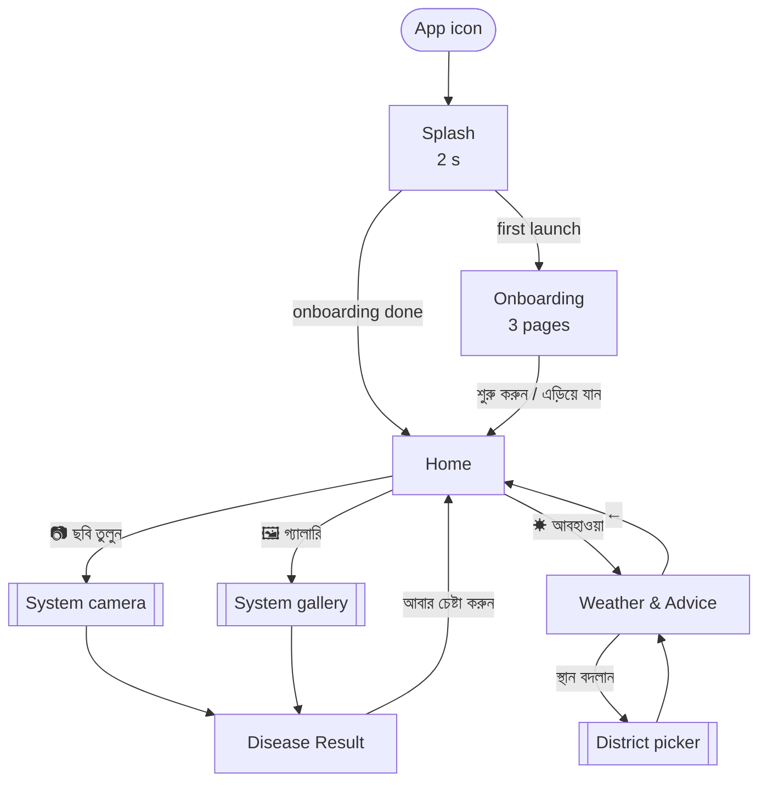
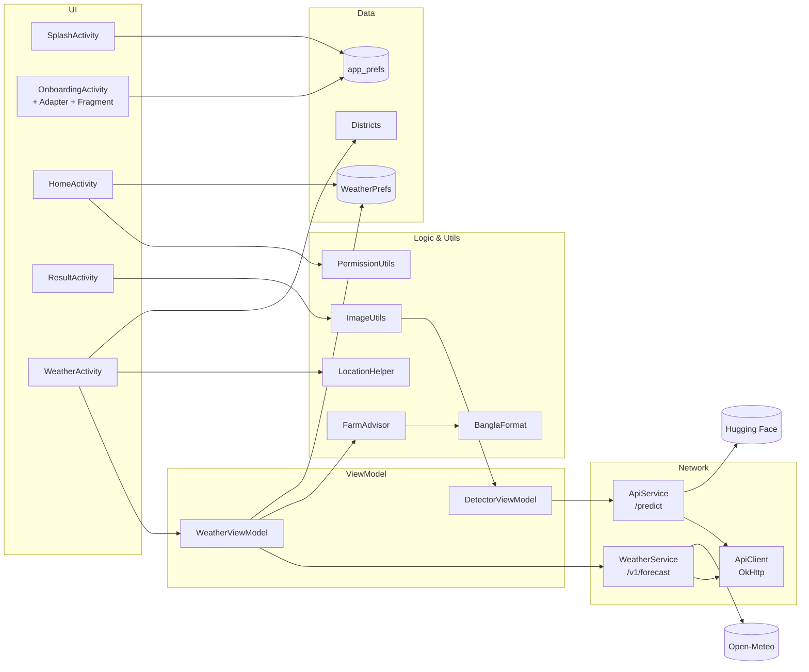
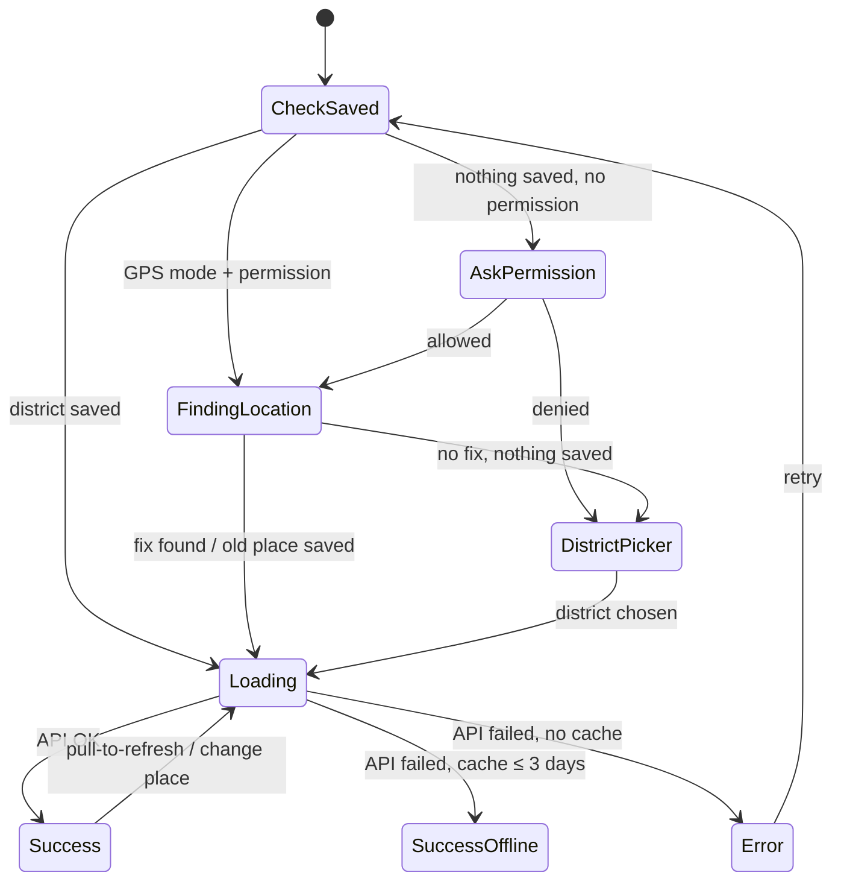
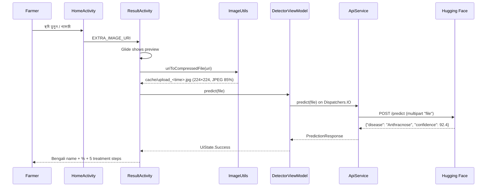

# 🥭 আমের রোগ নির্ণয় — Mango Disease Detector

### Complete App Documentation: all features, screen by screen

| Item | Detail |
|------|--------|
| App name | আমের রোগ নির্ণয় (Mango Disease Detector) |
| Package | `com.example.mango_disease_detector` |
| Platform | Android, Kotlin, XML views + ViewBinding |
| Min / Target SDK | 24 (Android 7.0) / 36 |
| Architecture | MVVM (Activity → ViewModel → Service) |
| Language | Bengali (বাংলা) UI, Bengali voice |
| Target users | Mango farmers in Bangladesh, including low-literacy users |
| Disease AI | Hugging Face Space (`rakibmist-mango-disease-detector.hf.space`) |
| Weather | Open-Meteo API (free, no key) |

---

## 📑 Contents

1. [Feature overview](#-feature-overview)
2. [Design principles](#-design-principles)
3. [App navigation map](#-app-navigation-map)
4. [Architecture](#-architecture)
5. [Screens](#-screens)
   - [1. Splash](#screen-1--splash)
   - [2. Onboarding](#screen-2--onboarding)
   - [3. Home](#screen-3--home)
   - [4. Disease Result](#screen-4--disease-result)
   - [5. Weather & Advice](#screen-5--weather--advice)
6. [Feature deep-dives](#-feature-deep-dives)
   - [Disease detection pipeline](#a-disease-detection-pipeline)
   - [Disease treatment advice](#b-disease-treatment-advice)
   - [Voice (Text-to-Speech)](#c-voice-text-to-speech)
   - [Weather & farming advice](#d-weather--farming-advice)
   - [Location](#e-location)
   - [Bengali formatting](#f-bengali-formatting)
7. [Data & storage](#-data--storage)
8. [External APIs](#-external-apis)
9. [Permissions](#-permissions)
10. [Project structure](#-project-structure)
11. [Resources (colours, strings, drawables, animations)](#-resources)
12. [Build, run & test](#-build-run--test)
13. [Known limitations & next steps](#-known-limitations--next-steps)

---

## ✨ Feature overview

| # | Feature | What the farmer gets | Where |
|---|---------|----------------------|-------|
| 1 | **Splash** | Branded loading screen | `SplashActivity` |
| 2 | **Onboarding** | 3-page intro, shown on first launch only | `OnboardingActivity` |
| 3 | **Take photo** | Camera capture of a mango leaf | `HomeActivity` |
| 4 | **Pick from gallery** | Choose an existing leaf photo | `HomeActivity` |
| 5 | **AI disease detection** | Disease name (8 classes) + confidence % | `ResultActivity` → HF API |
| 6 | **Treatment advice** | 5 numbered Bengali steps per disease | `ResultActivity` |
| 7 | **Voice read-out** | 🔊 Speaks the result, advice and weather in Bengali | `ResultActivity`, `WeatherActivity` |
| 8 | **Weather forecast** | Current weather + 7-day forecast for their district | `WeatherActivity` → Open-Meteo |
| 9 | **Farming advice** | Weather-based mango tips (spray, storm, disease risk, irrigation) | `FarmAdvisor` |
| 10 | **Location** | Auto GPS → nearest district, or pick from 64 districts | `LocationHelper`, `Districts` |
| 11 | **Offline weather** | Last forecast shown when there is no internet (≤ 3 days old) | `WeatherPrefs` |

---

## 🎨 Design principles

| Principle | How it is applied |
|-----------|-------------------|
| **Big & simple** | 64–72 dp buttons, 18–28 sp text, large icons and emoji |
| **Minimal reading** | Emoji + colour carry the meaning; voice reads the text aloud |
| **Bengali first** | All UI text, digits (২৫°), day names and voice are in Bengali |
| **Natural colours** | Green (`#2E7D32`) for primary actions, yellow (`#F9A825`) accent |
| **Colour = meaning** | 🟢 healthy/good · 🟡/🟠 caution · 🔴 disease/danger · 🔵 info |
| **Short flows** | Open → Photo → Result in 3 taps |
| **Works on weak networks** | Images are compressed to 224×224 before upload; weather is cached |

---

## 🗺️ App navigation map



---

## 🏗️ Architecture



| Layer | Classes | Notes |
|-------|---------|-------|
| **UI** | 5 Activities + 1 Fragment | ViewBinding, edge-to-edge, system-bar insets |
| **ViewModel** | `DetectorViewModel`, `WeatherViewModel` | `LiveData` + sealed UI state; coroutines on `Dispatchers.IO` |
| **Network** | `ApiClient`, `ApiService`, `WeatherService` | One shared OkHttp client; Gson parsing |
| **Logic** | `FarmAdvisor`, `BanglaFormat` | Pure Kotlin, unit-tested |
| **Platform** | `ImageUtils`, `PermissionUtils`, `LocationHelper` | Android APIs |
| **Data** | `Districts`, `WeatherPrefs`, `app_prefs` | Static list + SharedPreferences |

### Libraries

| Library | Version | Used for |
|---------|---------|----------|
| AndroidX Core / AppCompat / Activity | 1.18 / 1.7.1 / 1.13 | Base |
| Material Components | 1.13.0 | Theme, dialogs |
| ConstraintLayout | 2.2.1 | Layout |
| ViewPager2 | 1.1.0 | Onboarding pages |
| SwipeRefreshLayout | 1.1.0 | Weather pull-to-refresh |
| Lifecycle ViewModel / LiveData | 2.8.7 | MVVM |
| OkHttp | 4.12.0 | HTTP |
| Gson | 2.10.1 | JSON |
| Glide | 4.16.0 | Leaf image preview |
| Lottie | 6.4.0 | Declared, not used yet |

---

## 📱 Screens

### Screen 1 — Splash

**Files:** `ui/splash/SplashActivity.kt`, `layout/activity_splash.xml`
**Theme:** `Theme.MangoDiseaseDetector.Splash` (green window background)

```
┌──────────────────────────────┐
│                              │
│                              │
│            🍃                │  ← white leaf, fade-in animation
│                              │
│        আমের রোগ নির্ণয়           │  ← app name, 28sp white
│                              │
│      (green background)      │
└──────────────────────────────┘
```

| Behaviour | Detail |
|-----------|--------|
| Duration | 2 seconds (`Handler.postDelayed`) |
| Animation | Logo `fade_in`; transition `fade_in` / `fade_out` |
| Routing | Reads `app_prefs → onboarding_complete` |
| | `false` → **Onboarding** |
| | `true` → **Home** |
| Back stack | `finish()`, so Back never returns to the splash |

---

### Screen 2 — Onboarding

**Files:** `ui/onboarding/OnboardingActivity.kt`, `OnboardingAdapter.kt`, `OnboardingFragment.kt`, `layout/activity_onboarding.xml`, `layout/fragment_onboarding.xml`

Shown only on **first launch**.

```
┌──────────────────────────────┐
│                  এড়িয়ে যান     │  ← Skip
│                              │
│            🍃                │  ← 200dp icon
│                              │
│          ছবি তুলুন              │  ← title, 26sp green
│   আপনার আমের পাতার ছবি তুলুন      │  ← description, 18sp
│                              │
│            ● ○ ○             │  ← page dots (active = 12dp)
│ ┌──────────────────────────┐ │
│ │        পরবর্তী              │ │  ← "Next" / "শুরু করুন" on last page
│ └──────────────────────────┘ │
└──────────────────────────────┘
```

| Page | Icon | Title | Description |
|------|------|-------|-------------|
| 1 | 🍃 leaf | ছবি তুলুন | আপনার আমের পাতার ছবি তুলুন |
| 2 | 📷 camera | AI বিশ্লেষণ | আমাদের AI রোগ শনাক্ত করবে |
| 3 | 🍃 leaf | চিকিৎসা জানুন | সঠিক চিকিৎসা জানুন |

| Action | Result |
|--------|--------|
| Swipe / পরবর্তী | Next page; dots update |
| শুরু করুন (last page) | Saves `onboarding_complete = true` → Home |
| এড়িয়ে যান | Same as above, from any page |

---

### Screen 3 — Home

**Files:** `ui/home/HomeActivity.kt`, `layout/activity_home.xml`, `utils/PermissionUtils.kt`

```
┌──────────────────────────────┐
│            🍃                │  ← 140dp leaf
│        আমের রোগ নির্ণয়           │  ← 28sp green
│    পাতার ছবি তুলুন বা বেছে নিন      │
│                              │
│ ┌──────────────────────────┐ │
│ │   📷   ছবি তুলুন            │ │  ← solid green, 72dp
│ └──────────────────────────┘ │
│ ┌──────────────────────────┐ │
│ │   🖼   গ্যালারি থেকে বেছে নিন   │ │  ← green outline
│ └──────────────────────────┘ │
│ ┌──────────────────────────┐ │
│ │   ☀   আবহাওয়া · ☁️ ২৫°      │ │  ← green outline, yellow sun
│ └──────────────────────────┘ │
└──────────────────────────────┘
```

| Button | ID | Flow |
|--------|----|------|
| ছবি তুলুন | `btnCamera` | Check `CAMERA` permission → ask if needed → create `cache/camera_<time>.jpg` via `FileProvider` → `TakePicture()` → on success open **Result** |
| গ্যালারি থেকে বেছে নিন | `btnGallery` | Check `READ_MEDIA_IMAGES` (API 33+) or `READ_EXTERNAL_STORAGE` → `GetContent("image/*")` → open **Result** |
| আবহাওয়া | `btnWeather` | Opens **Weather** |
| Temp badge | `tvHomeWeatherTemp` | In `onResume()`: shows cached weather emoji + temperature; hidden if there is no cache |

If permission is denied, a toast shows "অনুমতি দেওয়া হয়নি".

The image URI is passed to Result as the extra `EXTRA_IMAGE_URI`. The transition is `slide_in_right` / `slide_out_left`.

---

### Screen 4 — Disease Result

**Files:** `ui/result/ResultActivity.kt`, `viewmodel/DetectorViewModel.kt`, `network/ApiService.kt`, `utils/ImageUtils.kt`, `layout/activity_result.xml`

```
┌──────────────────────────────┐
│ রোগ নির্ণয়ের ফলাফল                 │
│ ┌──────────────────────────┐ │
│ │                          │ │
│ │     [ leaf photo ]       │ │  ← Glide, 240dp, centerCrop
│ │                          │ │
│ └──────────────────────────┘ │
│                              │
│ ┌──────────────────────────┐ │
│ │ অ্যানথ্রাকনোজ           (🔊)│ │  ← red if disease, green if healthy
│ │ নিশ্চিততা: 92.4%            │ │
│ └──────────────────────────┘ │
│                              │
│ ┌──────────────────────────┐ │
│ │ ⚠️ করণীয় পদক্ষেপ       (🔊)│ │  ← yellow header (green if healthy)
│ │ ──────────────────────── │ │
│ │ (১) 🍂 আক্রান্ত পাতা ও ফল…    │ │
│ │ (২) 🔥 তুলে ফেলা পাতা…       │ │
│ │ (৩) 💊 ম্যানকোজেব বা…        │ │
│ │ (৪) 🔁 প্রতি ১৫ দিনে…         │ │
│ │ (৫) 💧 গাছের গোড়ায়…         │ │
│ └──────────────────────────┘ │
│ ┌──────────────────────────┐ │
│ │     আবার চেষ্টা করুন          │ │  ← back to Home
│ └──────────────────────────┘ │
└──────────────────────────────┘
```

#### States (`UiState`)

| State | What shows |
|-------|-----------|
| `Idle` | Starts the prediction automatically |
| `Loading` | Spinner + "বিশ্লেষণ করা হচ্ছে…" |
| `Success` | Result card (with `bounce` animation) + advice card (with `fade_in`) |
| `Error` | Red text "সংযোগে সমস্যা হয়েছে। আবার চেষ্টা করুন।" |

#### Interactions

| Action | Result |
|--------|--------|
| 🔊 on the result card | Speaks "{disease}। নিশ্চিততা X শতাংশ।" |
| 🔊 on the advice card | Speaks the header + "১। step… ২। step…" |
| আবার চেষ্টা করুন | `finish()` → Home |

The pipeline is described in [Disease detection pipeline](#a-disease-detection-pipeline).

---

### Screen 5 — Weather & Advice

**Files:** `ui/weather/WeatherActivity.kt`, `viewmodel/WeatherViewModel.kt`, `network/WeatherService.kt`, `utils/FarmAdvisor.kt`, `utils/BanglaFormat.kt`, `utils/LocationHelper.kt`, `data/Districts.kt`, `data/WeatherPrefs.kt`, `layout/activity_weather.xml`, `layout/item_advice.xml`, `layout/item_forecast_day.xml`

#### 5a. Main content

```
┌──────────────────────────────┐
│ ←  আবহাওয়া ও পরামর্শ        (🔊) │
│ 📍 ঢাকা           [স্থান বদলান] │
│ ⚠️ ইন্টারনেট নেই — আগের তথ্য…    │  ← only when offline
│ ╔══════════════════════════╗ │
│ ║ ২৫°                  ☁️   ║ │  ← green gradient card
│ ║ আংশিক মেঘলা                ║ │
│ ║ অনুভূত ২৯°                  ║ │
│ ║ সর্বোচ্চ ৩০° · সর্বনিম্ন ২৪°    ║ │
│ ║ [💧 ৮১%] [🌧️ ০%] [💨 ৭ কিমি/ঘ]║ │
│ ╚══════════════════════════╝ │
│         সর্বশেষ আপডেট: আজ রাত ১০:০৯ │
│ 🌾 আম চাষির জন্য পরামর্শ           │
│ ┌ ✅ আবহাওয়া ভালো। …          ┐ │  ← GOOD (green)
│ ┌ 🌱 সার দেওয়ার সময়। …         ┐ │  ← INFO (blue)
│ 🌦️ ৭ দিনের পূর্বাভাস              │
│ [আজ][আগামীকাল][শুক্র][শনি]… →   │  ← horizontal scroll
│   আবহাওয়ার তথ্যসূত্র: Open-Meteo.com │
└──────────────────────────────┘
```

#### 5b. Other states

| State | Display |
|-------|---------|
| First open, no permission | Android "approximate location" dialog |
| `Loading(findingLocation)` | Spinner + "আপনার অবস্থান খোঁজা হচ্ছে…" (max 10 s) |
| `Loading()` | Spinner + "আবহাওয়ার তথ্য আনা হচ্ছে…" |
| District picker | "📍 আমার বর্তমান অবস্থান" + 64 districts (Bengali order) + বাতিল |
| `Success(fromCache = true)` | Normal screen + orange offline banner |
| `Error` | 📡 + error text + "আবার চেষ্টা করুন" button |

#### Weather screen states



#### Interactions

| Action | Result |
|--------|--------|
| Pull down | Refresh (re-gets GPS if in GPS mode) |
| স্থান বদলান | District picker |
| 🔊 | Speaks place, condition, temperature, humidity, rain chance, all advice |
| ← | Home |

The details are in [Weather & farming advice](#d-weather--farming-advice).

---

## 🔍 Feature deep-dives

### A. Disease detection pipeline



| Step | Detail |
|------|--------|
| Image prep | Decode → scale to **224 × 224** → JPEG quality 85 → `cacheDir` |
| Request | `POST https://rakibmist-mango-disease-detector.hf.space/predict`, multipart field `file` |
| Response | `PredictionResponse(disease: String, confidence: Float)` |
| Timeouts | Connect 30 s, read/write 60 s (a sleeping HF Space can take a while to wake) |
| Errors | Non-2xx or empty body → `UiState.Error` |

#### Supported classes (8)

| API label | Bengali | Type |
|-----------|---------|------|
| `Anthracnose` | অ্যানথ্রাকনোজ | Fungal |
| `Bacterial Canker` | ব্যাকটেরিয়াল ক্যাংকার | Bacterial |
| `Cutting Weevil` | কাটিং উইভিল | Insect |
| `Die Back` | ডাই ব্যাক | Fungal |
| `Gall Midge` | গল মিজ | Insect |
| `Healthy` | সুস্থ ✅ | — |
| `Powdery Mildew` | পাউডারি মিলডিউ | Fungal |
| `Sooty Mould` | সুটি মোল্ড | Fungal |

---

### B. Disease treatment advice

**Source:** `ResultActivity.diseaseAdviceMap`. Every class has 5 numbered steps with emoji.

| Disease | Key actions (summary) |
|---------|------------------------|
| **Anthracnose** | Remove infected leaves/fruit → bury or burn → spray **Mancozeb or Copper oxychloride** → every 15 days → avoid waterlogging |
| **Bacterial Canker** | Cut infected parts → apply **Bordeaux paste** → spray **Copper hydroxide** → every 10 days → bury debris |
| **Cutting Weevil** | Cut affected shoots → spray **Chlorpyrifos** → hand-pick insects → keep the base clean → check weekly |
| **Die Back** | Prune dead branches → **Bordeaux paste** → spray **Carbendazim** → fertiliser + water → check every 15 days |
| **Gall Midge** | Remove and burn galled buds → spray **Imidacloprid** → spray before flowering → keep the orchard clean → every 10 days |
| **Powdery Mildew** | Remove infected leaves/flowers → spray **Sulphur or Hexaconazole** → every 10 days → don't overwater → improve airflow |
| **Sooty Mould** | Wipe leaves with soap water → spray insecticide (for the honeydew insects) → cut affected leaves → ensure light and air → check every 15 days |
| **Healthy** ✅ | Tree is fine → regular water → timely fertiliser → keep clean → check weekly |

The steps are shown in coloured number circles (green if healthy, yellow if diseased), numbered with Bengali digits ১–৫.

---

### C. Voice (Text-to-Speech)

Used on the **Result** and **Weather** screens.

| Item | Detail |
|------|--------|
| Engine | Android `TextToSpeech` |
| Locale | `Locale("bn", "BD")` |
| Ready check | `LANG_MISSING_DATA` / `LANG_NOT_SUPPORTED` → toast "ভয়েস সাপোর্ট প্রস্তুত নয়" |
| Cleanup | `stop()` + `shutdown()` in `onDestroy()` |
| Result screen | Strips emoji from the advice header before speaking |
| Weather screen | Replaces `%` → শতাংশ, `°` → ডিগ্রি; brackets become pauses |

> If a phone has no Bengali voice, the farmer needs to install it: **Settings → Language → Text-to-speech → Google → install Bengali (Bangladesh)**.

---

### D. Weather & farming advice

#### API request (Open-Meteo)

```
GET https://api.open-meteo.com/v1/forecast
  ?latitude=..&longitude=..
  &current=temperature_2m,relative_humidity_2m,apparent_temperature,
           weather_code,wind_speed_10m,wind_gusts_10m,is_day
  &hourly=temperature_2m,relative_humidity_2m,precipitation_probability,
          precipitation,wind_gusts_10m
  &daily=weather_code,temperature_2m_max,temperature_2m_min,
         precipitation_probability_max,precipitation_sum,wind_gusts_10m_max
  &timezone=Asia/Dhaka&forecast_days=7
```

#### Advice engine (`FarmAdvisor`)

The engine looks at the **next 24 hours** (from the current hour), plus today's max/min, the next 3 days' rain, and the **month**.

| # | Rule | Trigger | Level |
|---|------|---------|-------|
| 1 | Storm (named **Kalbaishakhi** in Mar–May) | gust ≥ 60 km/h | 🔴 DANGER |
| 1b | Windy, don't spray | gust 40–60 km/h | 🟠 CAUTION |
| 2 | Heavy rain, clear drains | rain ≥ 50 mm / 24 h | 🔴 DANGER |
| 3 | Don't spray, rain will wash it off | rain chance ≥ 60% | 🟠 CAUTION |
| 4 | Anthracnose risk | humidity ≥ 80% + 20–32 °C + wet | 🔴 DANGER |
| 5 | Powdery mildew risk | Jan–Mar + humidity ≥ 60% + night 10–20 °C | 🟠 CAUTION |
| 6 | Heat, irrigate in the evening | max ≥ 36 °C + < 2 mm rain in 3 days | 🟠 CAUTION |
| 7 | Good day to spray / harvest | no warnings + rain < 30% + gust < 30 | 🟢 GOOD |
| 8 | Seasonal tip | always | 🔵 INFO |

The cards are sorted 🔴 → 🟠 → 🟢 → 🔵, so the most urgent is on top.

#### Seasonal mango calendar

| Months | Stage | Tip |
|--------|-------|-----|
| Dec–Jan | Before flowering | 🌸 Don't irrigate, it helps flowering |
| Feb–Mar | Flowering / fruit set | 🌼 Watch for hopper & powdery mildew |
| Apr–May | Fruit growth | 🥭 Irrigate every 15 days |
| Jun–Jul | Harvest | 🧺 Pick on dry days, in the morning |
| Aug–Sep | Post-harvest | ✂️ Prune dead/diseased branches |
| Oct–Nov | Fertilising | 🌱 Fertilise + light irrigation |

#### Disease ↔ weather link

The weather advice connects to the detector's disease classes:

| Weather risk rule | Detector class | Same treatment as Result screen |
|-------------------|----------------|----------------------------------|
| Anthracnose risk | `Anthracnose` | Mancozeb / Carbendazim |
| Powdery mildew risk | `Powdery Mildew` | Sulphur |

> ⚠️ The rules are practical heuristics, not a validated agronomic model. They should be reviewed by an agriculture expert (BARI / DAE) before real-world reliance.

More detail is in [`weather-feature.md`](weather-feature.md).

---

### E. Location

**File:** `utils/LocationHelper.kt`. This uses the platform `LocationManager`, so **no Google Play Services** are needed.

```
1. No permission                      → null → district picker
2. Last known fix < 30 min old        → use it
3. Ask network + fused + gps together → first fix wins (10 s timeout)
4. Timeout                            → last known fix (any age)
5. Nothing                            → district picker
```

| Item | Detail |
|------|--------|
| Permission | `ACCESS_COARSE_LOCATION` only |
| API 30+ | `getCurrentLocation()` + `CancellationSignal` |
| API 24–29 | `requestSingleUpdate()` |
| GPS → name | Nearest of 64 district HQs (`Districts.nearest`) |
| Outside Bangladesh | Shows "আমার অবস্থান" (box: lat 20.5–26.7, lon 88.0–92.7) |

**Why all providers at once:** during testing, the network provider was enabled on the Pixel 7 emulator but never answered.

---

### F. Bengali formatting

**File:** `utils/BanglaFormat.kt`

| Function | In | Out |
|----------|----|-----|
| `digits()` | `2026-11-04` | `২০২৬-১১-০৪` |
| `temp()` | `27.6` | `২৮°` |
| `dayLabel(d, 0/1/n)` | dates | `আজ` / `আগামীকাল` / `শুক্র` |
| `updatedAt()` | 15:05 today | `আজ বিকেল ৩:০৫` |
| `weatherText(code)` | `95` | `বজ্রসহ বৃষ্টি` |
| `weatherEmoji(code)` | `95` | `⛈️` |

Time of day: সকাল 4–11 · দুপুর 12–14 · বিকেল 15–17 · সন্ধ্যা 18–19 · রাত 20–3.

---

## 💾 Data & storage

| Store | Key | Written by | Read by |
|-------|-----|-----------|---------|
| `app_prefs` | `onboarding_complete` | Onboarding | Splash |
| `weather_prefs` | `place_name`, `place_lat`, `place_lon`, `place_is_gps` | Weather (GPS / picker) | Weather |
| `weather_prefs` | `weather_cache` (JSON) | WeatherViewModel | Weather (offline), Home badge |
| `cacheDir` | `camera_<time>.jpg` | Home (camera) | Result |
| `cacheDir` | `upload_<time>.jpg` | ImageUtils | ApiService |

- The weather cache expires after **3 days**.
- No user account, no server-side storage. Photos are sent only to the prediction API.

---

## 🌐 External APIs

| API | Endpoint | Auth | Purpose | Notes |
|-----|----------|------|---------|-------|
| **Hugging Face Space** | `POST /predict` | none | Disease classification | A free Space may "sleep"; the first request can be slow |
| **Open-Meteo** | `GET /v1/forecast` | none | Weather | Free for **non-commercial** use; attribution shown on screen |

Both use the shared `ApiClient.client` (OkHttp).

---

## 🔐 Permissions

| Permission | Why | When asked |
|------------|-----|-----------|
| `INTERNET` | AI + weather APIs | Granted automatically |
| `CAMERA` | Take leaf photo | On tapping ছবি তুলুন |
| `READ_MEDIA_IMAGES` (API 33+) | Gallery | On tapping গ্যালারি |
| `READ_EXTERNAL_STORAGE` (≤ API 32) | Gallery | On tapping গ্যালারি |
| `ACCESS_COARSE_LOCATION` | Weather for the farmer's district | First weather open / "আমার বর্তমান অবস্থান" |

Camera and location hardware are marked `required="false"`, so the app installs on devices without them.

`FileProvider` authority: `${applicationId}.provider`, sharing only `cache/` (`xml/file_paths.xml`).

---

## 🗂️ Project structure

```
app/src/main/
├── AndroidManifest.xml
├── java/com/example/mango_disease_detector/
│   ├── MainActivity.kt                 # template leftover, not used
│   ├── data/
│   │   ├── Districts.kt                # 64 districts + nearest lookup
│   │   └── WeatherPrefs.kt             # saved place + weather cache
│   ├── model/
│   │   ├── PredictionResponse.kt       # {disease, confidence}
│   │   └── WeatherResponse.kt          # Open-Meteo models
│   ├── network/
│   │   ├── ApiClient.kt                # OkHttp + BASE_URL
│   │   ├── ApiService.kt               # POST /predict
│   │   └── WeatherService.kt           # GET /v1/forecast
│   ├── ui/
│   │   ├── splash/SplashActivity.kt
│   │   ├── onboarding/
│   │   │   ├── OnboardingActivity.kt
│   │   │   ├── OnboardingAdapter.kt    # FragmentStateAdapter
│   │   │   └── OnboardingFragment.kt
│   │   ├── home/HomeActivity.kt
│   │   ├── result/ResultActivity.kt    # + disease names & advice maps
│   │   └── weather/WeatherActivity.kt
│   ├── utils/
│   │   ├── BanglaFormat.kt
│   │   ├── FarmAdvisor.kt
│   │   ├── ImageUtils.kt
│   │   ├── LocationHelper.kt
│   │   └── PermissionUtils.kt
│   └── viewmodel/
│       ├── DetectorViewModel.kt        # UiState
│       └── WeatherViewModel.kt         # WeatherUiState
└── res/
    ├── anim/        bounce, fade_in, fade_out, slide_in_right, slide_out_left
    ├── drawable/    buttons, cards, icons (see Resources)
    ├── layout/      activity_* (6), fragment_onboarding, item_advice, item_forecast_day
    ├── values/      strings.xml (Bengali), colors.xml, themes.xml
    └── xml/         file_paths, backup_rules, data_extraction_rules

app/src/test/java/com/example/mango_disease_detector/
├── ExampleUnitTest.kt
├── FarmAdvisorTest.kt                  # 11 tests
└── BanglaFormatTest.kt                 # 7 tests
```

---

## 🎨 Resources

### Colours (`values/colors.xml`)

| Name | Hex | Use |
|------|-----|-----|
| `green_primary` | `#2E7D32` | Buttons, titles, healthy |
| `green_dark` | `#1B5E20` | Variant |
| `green_light` | `#4CAF50` | Accents |
| `green_surface` | `#E8F5E9` | Today forecast card |
| `yellow_accent` | `#F9A825` | Advice header, sun icon |
| `disease_color` | `#C62828` | Disease name, max temp |
| `background` | `#F5F5F5` | Screen background |
| `weather_card_start` → `end` | `#1B5E20` → `#43A047` | Weather card gradient |
| `advice_danger` / `_bg` | `#C62828` / `#FFEBEE` | 🔴 advice |
| `advice_caution` / `_bg` | `#EF8F00` / `#FFF8E1` | 🟠 advice |
| `advice_good` / `_bg` | `#2E7D32` / `#E8F5E9` | 🟢 advice |
| `advice_info` / `_bg` | `#1565C0` / `#E3F2FD` | 🔵 advice, min temp |

### Drawables

| Drawable | Used on |
|----------|---------|
| `bg_button_green`, `bg_button_outline` | All big buttons |
| `bg_card_result` | Result cards, forecast day cards |
| `bg_speak_button` | 🔊 round green buttons |
| `bg_onboarding_indicator_active/inactive` | Onboarding dots |
| `bg_weather_card`, `bg_weather_stat`, `bg_forecast_today` | Weather screen |
| `ic_leaf`, `ic_camera`, `ic_gallery`, `ic_volume_up`, `ic_weather` | Icons |

### Animations

| Anim | Used for |
|------|----------|
| `fade_in` / `fade_out` | Splash logo, screen transitions, advice and weather content |
| `slide_in_right` / `slide_out_left` | Home → Result / Weather, Onboarding → Home |
| `bounce` | Result card appearing |

### Strings

All UI text is in `values/strings.xml`, in Bengali. The groups are: onboarding, home, result, disease names, permissions, and weather (`weather_*`). The disease advice text lives in `ResultActivity.diseaseAdviceMap`. The weather advice text lives in `FarmAdvisor`.

---

## 🛠️ Build, run & test

```bash
# Build debug APK
./gradlew assembleDebug                 # → app/build/outputs/apk/debug/app-debug.apk

# Install on a connected device (pick one with -s if several)
adb -s <serial> install -r app/build/outputs/apk/debug/app-debug.apk

# Unit tests (19 tests)
./gradlew :app:testDebugUnitTest
```

### Handy test commands

```bash
# Reset app (shows onboarding again, clears weather location/cache)
adb shell pm clear com.example.mango_disease_detector

# Emulator: set GPS to Rajshahi
adb emu geo fix 88.6042 24.3745

# Grant location without the dialog
adb shell pm grant com.example.mango_disease_detector android.permission.ACCESS_COARSE_LOCATION
```

> Activities other than Splash are not exported, so launch the app via its icon or `adb shell monkey -p com.example.mango_disease_detector -c android.intent.category.LAUNCHER 1`.

### Test coverage

| Area | Automated | Manual |
|------|-----------|--------|
| Farming advice rules | ✅ 11 tests | ✅ |
| Bengali formatting, districts | ✅ 7 tests | ✅ |
| Weather screen, GPS | — | ✅ Realme RMX3630 |
| Disease detection flow | — | (existing feature) |
| Voice | — | ⚠️ not verified by ear |

---

## 🚧 Known limitations & next steps

| # | Area | Issue | Suggestion |
|---|------|-------|-----------|
| 1 | Detection | `ImageUtils` stretches the photo to 224×224 (aspect ratio not kept) and ignores EXIF rotation | Centre-crop + read EXIF orientation |
| 2 | Detection | The full-size camera bitmap is decoded before scaling (memory spike on low-end phones) | Use `inSampleSize` when decoding |
| 3 | Detection | Image compression runs on the main thread in `ResultActivity.startPrediction` | Move into `DetectorViewModel` on `Dispatchers.IO` |
| 4 | Detection | No offline handling: every failure shows the same generic error | Detect no-internet separately; keep a history of past results |
| 5 | UI | Status-bar icons are white on the light background in system dark mode | Set light status bar (`isAppearanceLightStatusBars = true`) |
| 6 | UI | District picker dialog follows system dark theme | Force a light dialog theme |
| 7 | Code | `MainActivity` + `activity_main.xml` are unused template files; Lottie is declared but unused | Remove |
| 8 | Weather | Advice rules not expert-reviewed | Review with an agronomist |
| 9 | Weather | No push alerts | Daily `WorkManager` storm/rain notification |
| 10 | Licensing | Open-Meteo free tier is non-commercial | Paid plan if commercialised |
| 11 | Voice | Depends on the Bengali TTS voice being installed | Show install instructions in-app |
