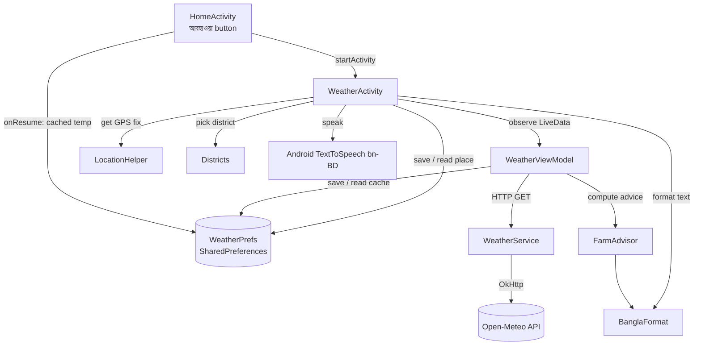
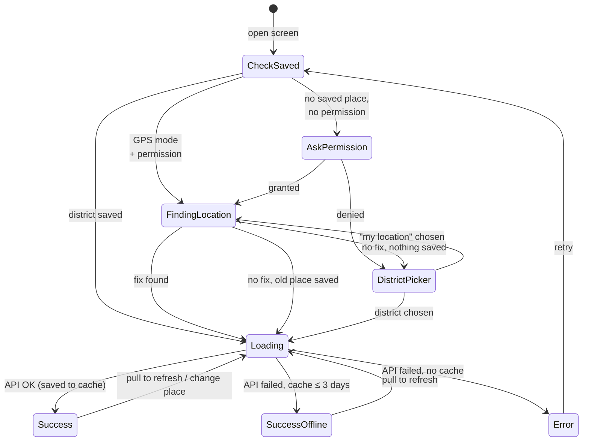
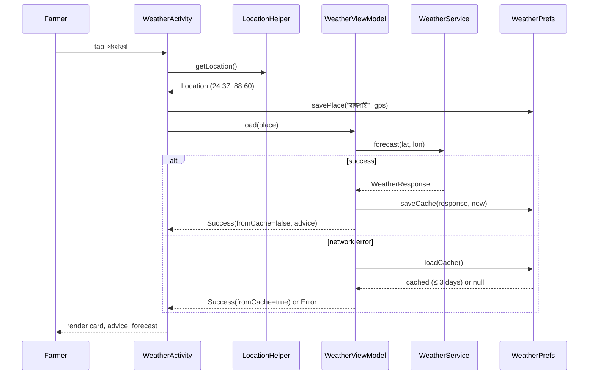

# 🌦️ Weather & Farming Advice — Feature Documentation

### আবহাওয়া ও পরামর্শ | Mango Disease Detector

| Item | Detail |
|------|--------|
| Feature | 7-day weather forecast + mango-specific farming advice |
| Target user | Mango farmers in Bangladesh (low-literacy friendly) |
| Language | Bengali (বাংলা): text, digits, day names, voice |
| Weather source | [Open-Meteo](https://open-meteo.com): free, no API key |
| Location | Coarse GPS, or manual pick from 64 districts |
| Offline | Last forecast cached, shown for up to 3 days |
| History | Added in `96623fe`; restyled to the v2 design in `ffddc5f` |
| Visual design | See **Design system** and **Screen 6** in [`APP_DOCUMENTATION.md`](APP_DOCUMENTATION.md) |

---

## 📑 Contents

1. [What the feature does](#-what-the-feature-does)
2. [Architecture](#-architecture)
3. [Screen-by-screen walkthrough](#-screen-by-screen-walkthrough)
4. [Location flow](#-location-flow)
5. [Data flow & API](#-data-flow--api)
6. [Farming advice engine](#-farming-advice-engine)
7. [Bengali formatting](#-bengali-formatting)
8. [Offline cache](#-offline-cache)
9. [Voice read-out](#-voice-read-out)
10. [File map](#-file-map)
11. [Testing](#-testing)
12. [Known limitations & future work](#-known-limitations--future-work)

---

## 🎯 What the feature does

A farmer taps **আবহাওয়া** on the home screen and sees:

- **Today's weather** for their district: temperature, condition, humidity, rain chance and wind.
- **Advice for mango farming** based on the next 24 hours and the current month. Examples: "don't spray today, rain will wash it off", "storm coming, tie weak branches", "anthracnose risk is high".
- **7-day forecast**: a scrollable strip of daily cards.
- **🔊 Voice**: one tap reads everything aloud in Bengali.

Design principles are the same as the rest of the app: big text, big icons, colour-coded cards, minimal reading needed.

---

## 🏗️ Architecture

The feature follows the app's existing **MVVM** pattern, with no new heavy libraries. It uses OkHttp + Gson, as `DetectorViewModel` does.



### Layers

| Layer | Class | Responsibility |
|-------|-------|----------------|
| UI | `ui/weather/WeatherActivity` | Permission, location, rendering, district picker, voice |
| UI | `ui/home/HomeActivity` | Weather button + cached temperature badge |
| ViewModel | `viewmodel/WeatherViewModel` | Loads forecast, falls back to cache, exposes `WeatherUiState` |
| Network | `network/WeatherService` | Builds Open-Meteo URL, parses JSON |
| Model | `model/WeatherResponse` | Gson data classes (`current`, `hourly`, `daily`) |
| Data | `data/WeatherPrefs` | Saved location + offline cache |
| Data | `data/Districts` | 64 districts with coordinates, nearest-district lookup |
| Logic | `utils/FarmAdvisor` | Rule-based mango farming advice (pure Kotlin, unit-tested) |
| Logic | `utils/BanglaFormat` | Bengali digits, day names, weather text, greetings, time labels |
| UI | `ui/weather/WeatherIcons` | WMO code → `wx_*` weather icon |
| UI | `ui/weather/AdviceStyle` | Advice level → label, icon, colours |
| Platform | `utils/LocationHelper` | Coarse location via `LocationManager` (no Play Services) |

### UI state

```kotlin
sealed class WeatherUiState {
    data class Loading(val findingLocation: Boolean = false)
    data class Success(weather, placeName, updatedAt, fromCache, advice)
    object Error
}
```

The ViewModel survives screen rotation, so the forecast is **not** fetched again on rotation.

---

## 📱 Screen-by-screen walkthrough

Full mockups, colours and component specs are in [`APP_DOCUMENTATION.md`](APP_DOCUMENTATION.md) (Design system, Screen 3 Home, Screen 6 Weather). This section covers the weather-specific behaviour.

### Home entry points

| Element | ID | Behaviour |
|---------|----|-----------|
| Weather chip (green header) | `chipWeather` | Cached weather icon + temperature; opens Weather; hidden with no cache |
| Weather card (sky blue) | `btnWeather` | Opens Weather; shows "২৫° · আংশিক মেঘলা" and a badge: "Nটি জরুরি পরামর্শ" (count of DANGER + CAUTION) or "জরুরি কিছু নেই"; with no cache it shows "দেখতে চাপ দিন" |
| Place | `tvPlace` | Saved district name |
| Result screen link | `btnWeather` in `activity_result.xml` | "স্প্রের আগে আবহাওয়া দেখুন" opens Weather from a disease result |

All of these refresh in `HomeActivity.onResume()` from `WeatherPrefs.loadCache()`.

### Weather screen layout

```
┌──────────────────────────────┐
│ [‹]  আবহাওয়া ও পরামর্শ       (🔊) │  ← back tile, raised green speaker
│ 📍 ঢাকা             (স্থান বদলান) │  ← tvLocation, btnChangeLocation
│ ┌ offline banner ┐             │  ← tvOffline (only from cache)
│ ╭────────────────────────────╮│
│ │ ২৫°                  ◖☁◗  ││  ← tvTemperature, ivWeatherIcon (white)
│ │ আংশিক মেঘলা                 ││  ← tvCondition
│ │ অনুভূত ২৮° · সর্বোচ্চ ৩০° · সর্বনিম্ন ২৪° ││  ← tvDetails
│ │ [💧 ৮২%][🌧 ০%][≋ ৭ কিমি]     ││  ← tvHumidity, tvRainChance, tvWind
│ ╰────────────────────────────╯│
│           সর্বশেষ আপডেট: আজ রাত ১০:৫০ │  ← tvUpdated
│ 🍃 আম চাষির জন্য পরামর্শ           │
│ [advice cards]                 │  ← layoutAdvice ← item_advice.xml
│ ৭ দিনের পূর্বাভাস                  │
│ [আজ][আগামীকাল][শুক্র] … →        │  ← layoutForecast ← item_forecast_day.xml
│   আবহাওয়ার তথ্যসূত্র: Open-Meteo.com │
└──────────────────────────────┘
```

| Section | Data source |
|---------|-------------|
| Temperature, condition, icon | `current.temperature`, `current.weatherCode`, `current.isDay` |
| Details line | `current.feelsLike`, `daily.tempMax/Min[today]` |
| Rain tile | **max rain chance over the next 24 h** (`FarmAdvisor.next24h`) |
| Advice | `FarmAdvisor.advise()` → `AdviceStyle.of(level)` |
| Forecast | `daily[today..]`; today uses `bg_day_today` |

### States

| State | Display |
|-------|---------|
| First open, no permission | Android "approximate location" dialog |
| `Loading(findingLocation = true)` | Sky spinner + "আপনার অবস্থান খোঁজা হচ্ছে…" (max 10 s) |
| `Loading()` | Sky spinner + "আবহাওয়ার তথ্য আনা হচ্ছে…" (pull-to-refresh keeps old content visible) |
| District picker | Light Material dialog: "আমার বর্তমান অবস্থান (GPS)" + 64 districts in Bengali order + বাতিল |
| `Success(fromCache = true)` | Normal screen + orange banner "ইন্টারনেট নেই — আগের তথ্য দেখানো হচ্ছে" |
| `Error` | Light-blue card: cloud tile, error text, raised **আবার চেষ্টা করুন** |

### District picker rules

- **বাতিল** closes the dialog. If no location was ever chosen, it also closes the screen.
- If no location is saved yet, tapping outside the dialog doesn't dismiss it.
- Choosing a district saves it (`isGps = false`); "আমার বর্তমান অবস্থান" retries GPS.

---

### State diagram



---

## 📍 Location flow

**File:** `utils/LocationHelper.kt`

This uses the platform `LocationManager`, so it works on phones **without Google Play Services**.

```
getLocation()
 ├─ no permission? ──────────────────────────► null
 ├─ last known fix < 30 min old? ────────────► return it
 ├─ ask ALL enabled providers at once:
 │     network  (all versions)
 │     fused    (Android 12+)
 │     gps      (Android 12+, coarsened by OS)
 │   first non-null fix wins, others cancelled
 ├─ 10 s timeout ───────────────────────────► fall back to last known (any age)
 └─ nothing ───────────────────────────────► null → district picker
```

**Why race the providers?** During testing on the Pixel 7 emulator, the network provider was "enabled" but never returned a fix. Asking only one provider meant a 10 s wait and then failure. Asking all of them at once fixed it.

| API level | Method |
|-----------|--------|
| 30+ | `LocationManager.getCurrentLocation()` with `CancellationSignal` |
| 24–29 | `requestSingleUpdate()` (deprecated but correct on old phones) |

**GPS → name:** `Districts.placeName(lat, lon)` returns the nearest district headquarters (by a cos-latitude-corrected distance). If the point is outside Bangladesh's bounding box (lat 20.5–26.7, lon 88.0–92.7), it shows **"আমার অবস্থান"** instead.

---

## 🌐 Data flow & API

**File:** `network/WeatherService.kt`

### Request

```
GET https://api.open-meteo.com/v1/forecast
    ?latitude=24.3745&longitude=88.6042
    &current=temperature_2m,relative_humidity_2m,apparent_temperature,
             weather_code,wind_speed_10m,wind_gusts_10m,is_day
    &hourly=temperature_2m,relative_humidity_2m,precipitation_probability,
            precipitation,wind_gusts_10m
    &daily=weather_code,temperature_2m_max,temperature_2m_min,
           precipitation_probability_max,precipitation_sum,wind_gusts_10m_max
    &timezone=Asia/Dhaka
    &forecast_days=7
```

- No API key is needed. The free tier is for non-commercial use, and attribution is shown on screen.
- Units: °C, km/h, mm (Open-Meteo defaults).
- The shared `ApiClient.client` is reused (30 s connect / 60 s read timeout).

### Response → model

| JSON | Kotlin (`WeatherResponse.kt`) | Used for |
|------|-------------------------------|----------|
| `current.temperature_2m` | `CurrentWeather.temperature` | Big temperature |
| `current.relative_humidity_2m` | `.humidity` | 💧 tile |
| `current.apparent_temperature` | `.feelsLike` | "অনুভূত" |
| `current.weather_code` | `.weatherCode` | Condition text + icon |
| `current.wind_speed_10m` | `.windSpeed` | 💨 tile |
| `current.wind_gusts_10m` | `.windGusts` | Storm rule |
| `current.is_day` | `.isDay` | `wx_sun` vs `wx_moon` |
| `hourly.*` (168 slots) | `HourlyWeather` | Next-24h window for advice |
| `daily.*` (7 days) | `DailyWeather` | Forecast strip, today's max/min |

All list fields are `List<Double?>`, because Open-Meteo can return `null` entries.

### Load sequence



---

## 🌾 Farming advice engine

**File:** `utils/FarmAdvisor.kt` (pure Kotlin, no Android dependencies)

### Inputs

`FarmAdvisor.next24h()` looks at the **24 hourly slots starting at the current hour** (matched against `current.time`, in Dhaka time):

| Value | How |
|-------|-----|
| `maxRainChance` | max of `precipitation_probability` |
| `rainSum` | sum of `precipitation` (mm) |
| `avgHumidity` | mean of `relative_humidity_2m` |
| `avgTemp` | mean of `temperature_2m` |
| `maxGust` | max of hourly gusts and the current gust |

It also uses **today's max/min**, the **rain sum for the next 3 days**, and the **month** (1–12).

### Advice model

```kotlin
enum class AdviceLevel { DANGER, CAUTION, GOOD, INFO }      // also the sort order
data class FarmAdvice(val level: AdviceLevel, val title: String, val text: String)
```

Each card shows a **label** (from the level), a bold **title** and a short **text** body.

| Level | Label | Icon tile | Card bg | Label / title / body colours |
|-------|-------|-----------|---------|------------------------------|
| `DANGER` | বিপদ | `ic_warning_line` on `#C62828` | `#FFEBEE` | `#B71C1C` / `#7F1414` / `#4A2020` |
| `CAUTION` | সাবধান | `ic_clock_line` on `#EF8F00` | `#FFF4DC` | `#8A4B00` / `#5C3300` / `#4A3B2C` |
| `GOOD` | ভালো খবর | `ic_check` on `#1F7A3A` | `#E7F5E9` | `#1F7A3A` / `#0F4D24` / `#2B3A2E` |
| `INFO` | মৌসুমি কাজ | `ic_sprout_line` on `#1E6BB8` | `#E3F0FC` | `#154F8A` / `#0F3A66` / `#24364A` |

### Rules

| # | Rule | Condition | Level | Title → text |
|---|------|-----------|-------|--------------|
| 1 | Storm | `maxGust ≥ 60 km/h` | DANGER | **কালবৈশাখী ঝড়ের আশঙ্কা** (Mar–May) / **ঝড়ো বাতাসের আশঙ্কা** → বাতাস ঘণ্টায় X কিমি পর্যন্ত… দুর্বল ডাল খুঁটি দিয়ে বেঁধে দিন। |
| 1b | Windy | `40 ≤ maxGust < 60` | CAUTION | **জোরে বাতাসের সম্ভাবনা** → আজ স্প্রে করবেন না, বাতাসে ওষুধ উড়ে যাবে। |
| 2 | Heavy rain | `rainSum ≥ 50 mm` | DANGER | **ভারী বৃষ্টির সম্ভাবনা** → বাগানের নালা পরিষ্কার রাখুন… |
| 3 | Spray window | `maxRainChance ≥ 60%` | CAUTION | **আজ স্প্রে করবেন না** → বৃষ্টির সম্ভাবনা X%। ছত্রাকনাশক বা কীটনাশক বৃষ্টিতে ধুয়ে যাবে। |
| 4 | Anthracnose | `avgHumidity ≥ 80%` **and** `20 ≤ avgTemp ≤ 32°C` **and** wet (`rainChance ≥ 50%` or `rainSum ≥ 2 mm`) | DANGER | **অ্যানথ্রাকনোজের ঝুঁকি** → পাতায় কালো দাগ খুঁজুন, বৃষ্টি থামলে ম্যানকোজেব বা কার্বেন্ডাজিম স্প্রে করুন। |
| 5 | Powdery mildew | month Jan–Mar **and** `avgHumidity ≥ 60%` **and** `10 ≤ todayMin ≤ 20°C` | CAUTION | **পাউডারি মিলডিউর ঝুঁকি** → মুকুলে সাদা গুঁড়া দেখলে সালফার জাতীয় ছত্রাকনাশক স্প্রে করুন। |
| 6 | Heat stress | `todayMax ≥ 36°C` **and** next 3 days rain `< 2 mm` | CAUTION | **তীব্র গরম (X°)** → বিকেলে গাছের গোড়ায় পানি দিন… |
| 7 | Good day | none of the above **and** `rainChance < 30%` **and** `gust < 30` | GOOD | **আজ কাজের ভালো দিন** → …স্প্রে (May–Jul: আম পাড়া) করার জন্য উপযুক্ত দিন। |
| 7b | Normal | none of the above, not calm enough for 7 | GOOD | **আবহাওয়া স্বাভাবিক** → নিয়মিত বাগান পরিচর্যা চালিয়ে যান। |
| 8 | Seasonal tip | always | INFO | see the table below |

The thresholds are `const val`s at the top of `FarmAdvisor` (`STORM_GUST_KMH`, `WINDY_GUST_KMH`, `HEAVY_RAIN_MM`, `NO_SPRAY_RAIN_CHANCE`, `HEAT_C`), so they are easy to tune.

### Seasonal mango calendar (Bangladesh)

| Months | Title | Text |
|--------|-------|------|
| Dec–Jan | মুকুল আসার আগের সময় | এখন গাছে সেচ দেবেন না, এতে মুকুল ভালো আসে। |
| Feb–Mar | মুকুল ও গুটি আসার সময় | হপার পোকা ও পাউডারি মিলডিউর দিকে নজর রাখুন। |
| Apr–May | গুটি বড় হওয়ার সময় | ১৫ দিন পরপর সেচ দিন, এতে গুটি ঝরা কমবে। |
| Jun–Jul | আম পাকা ও সংগ্রহের সময় | শুকনো দিনে, সকালের দিকে আম পাড়ুন। |
| Aug–Sep | ডাল ছাঁটার সময় | আম সংগ্রহের পর মরা, রোগা ও ঘন ডাল ছেঁটে দিন। |
| Oct–Nov | সার দেওয়ার সময় | গাছের গোড়ার চারপাশে সার দিয়ে হালকা সেচ দিন। |

> ⚠️ The rules are practical heuristics based on common Bangladeshi mango-growing guidance (BARI-style recommendations). They are not a validated agronomic model. An agriculture expert should review them before real-world use.

---

## 🔤 Bengali formatting

**File:** `utils/BanglaFormat.kt`

| Function | Example in | Example out |
|----------|-----------|-------------|
| `digits()` | `2026-11-04` | `২০২৬-১১-০৪` |
| `temp()` | `27.6` | `২৮°` |
| `number()` | `81.0` | `৮১` |
| `dayLabel(date, 0)` | today | `আজ` |
| `dayLabel(date, 1)` | tomorrow | `আগামীকাল` |
| `dayLabel("2026-11-06", 2)` | Friday | `শুক্র` |
| `updatedAt()` | 15:05 today | `আজ বিকেল ৩:০৫` |

**Time of day labels:** সকাল (4–11), দুপুর (12–14), বিকেল (15–17), সন্ধ্যা (18–19), রাত (20–3).

`greeting(hour)` uses the same bands for the home greeting: শুভ সকাল / শুভ দুপুর / শুভ বিকেল / শুভ সন্ধ্যা / শুভ রাত্রি.

### Weather codes (WMO → Bengali + icon)

| Code | Bengali (`weatherText`) | Icon (`weatherIconRes`) |
|------|-------------------------|-------------------------|
| 0 | পরিষ্কার আকাশ | `wx_sun` (night `wx_moon`) |
| 1, 2 | আংশিক মেঘলা | `wx_partly` (night `wx_cloud`) |
| 3 | মেঘলা আকাশ | `wx_cloud` |
| 45, 48 | কুয়াশা | `wx_fog` |
| 51–57 | গুঁড়ি গুঁড়ি বৃষ্টি | `wx_rain` |
| 61, 66, 80 | হালকা বৃষ্টি | `wx_rain` |
| 63, 81 | বৃষ্টি | `wx_rain` |
| 65, 67 | ভারী বৃষ্টি | `wx_rain` |
| 82 | ভারী বৃষ্টি | `wx_storm` |
| 95 | বজ্রসহ বৃষ্টি | `wx_storm` |
| 96, 99 | শিলাবৃষ্টি ও ঝড় | `wx_storm` |

The icons are full colour on white (home tile, forecast cards) and tinted white on the blue weather card.

---

## 💾 Offline cache

**File:** `data/WeatherPrefs.kt`. SharedPreferences file: `weather_prefs`.

| Key | Content |
|-----|---------|
| `place_name`, `place_lat`, `place_lon`, `place_is_gps` | Last chosen location |
| `weather_cache` | JSON of `CachedWeather(response, placeName, savedAt)` |

- The cache is written after **every** successful fetch.
- It is read when the fetch fails, and by the home screen badge.
- A cache **older than 3 days is ignored**, so old advice is never shown.
- When the cache is shown, the orange banner "⚠️ ইন্টারনেট নেই — আগের তথ্য দেখানো হচ্ছে" and the real update time make it clear.

---

## 🔊 Voice read-out

The voice button uses the same approach as `ResultActivity`: `TextToSpeech` with `Locale("bn", "BD")`.

Spoken text:

```
{জেলা}। আজকের আবহাওয়া {অবস্থা}। তাপমাত্রা {২৫} ডিগ্রি।
বাতাসের আর্দ্রতা {৮১} শতাংশ। বৃষ্টির সম্ভাবনা {০} শতাংশ।
পরামর্শ। {all advice texts…}
```

Before speaking, symbols are replaced: `%` → "শতাংশ", `°` → "ডিগ্রি", and brackets become pauses. Each advice item is read as "title। text". If the Bengali voice isn't installed, a toast shows "ভয়েস সাপোর্ট প্রস্তুত নয়".

---

## 🗂️ File map

```
app/src/main/java/com/example/mango_disease_detector/
├── data/
│   ├── Districts.kt            # 64 districts, nearest lookup, BD bounds check
│   └── WeatherPrefs.kt         # SavedPlace + CachedWeather persistence
├── model/
│   └── WeatherResponse.kt      # Gson models: Current/Hourly/Daily
├── network/
│   └── WeatherService.kt       # Open-Meteo request + parse
├── ui/weather/
│   ├── WeatherActivity.kt      # Screen, permission, picker, render, TTS
│   ├── AdviceStyle.kt          # Level → label, icon, 5 colours
│   └── WeatherIcons.kt         # weatherIconRes(code, isDay)
├── ui/home/HomeActivity.kt     # Weather chip, weather card, urgent count
├── utils/
│   ├── BanglaFormat.kt         # Digits, days, weather text, greeting, time
│   ├── FarmAdvisor.kt          # Advice rules (title + text) + seasonal tips
│   └── LocationHelper.kt       # Coarse location, providers raced
└── viewmodel/
    └── WeatherViewModel.kt     # WeatherUiState, network → cache fallback

app/src/main/res/
├── drawable/
│   ├── wx_sun / wx_moon / wx_partly / wx_cloud / wx_rain / wx_storm / wx_fog
│   ├── ic_pin, ic_drop_line, ic_rain_line, ic_wind_line, ic_cloud_line,
│   │   ic_warning_line, ic_clock_line, ic_check, ic_sprout_line, ic_leaf_line
│   ├── bg_day.xml / bg_day_today.xml          # Forecast cards
│   └── bg_pill_outline_green.xml               # "স্থান বদলান"
└── layout/
    ├── activity_weather.xml    # SwipeRefresh > ScrollView > sections
    ├── item_advice.xml         # Icon tile + label + title + text
    └── item_forecast_day.xml   # Day, icon, max, min, rain pill

app/src/test/java/com/example/mango_disease_detector/
├── FarmAdvisorTest.kt          # 11 tests (checks title + text)
└── BanglaFormatTest.kt         # 7 tests (incl. Districts)
```

The only dependency added for weather is **swiperefreshlayout 1.1.0**. Coroutines and `lifecycleScope` come from existing lifecycle libraries.

---

## ✅ Testing

### Unit tests

```bash
./gradlew :app:testDebugUnitTest
```

| Test class | Covers |
|------------|--------|
| `FarmAdvisorTest` | 24h window start, calm day → GOOD, rain → no spray, Kalbaishakhi storm, anthracnose wet/dry, heavy rain drainage, powdery mildew in Feb, heat → irrigate, severity sort order, today index |
| `BanglaFormatTest` | Bengali digits, temp rounding, আজ/আগামীকাল/weekday, time-of-day label, 64 districts, nearest district, outside-BD → null |

Result at commit: **19/19 passing** (including the existing `ExampleUnitTest`).

### Manual testing done

| Device | Result |
|--------|--------|
| Realme RMX3630 (real phone) | ✅ Permission dialog → GPS → **ঢাকা** → live forecast, advice, 7-day strip, home badge |
| Pixel 7 API 34 emulator | ✅ Fallback to district picker when no fix. ⚠️ Not re-tested after the provider-race fix |

### Emulator tips

```bash
# Set location to Rajshahi
adb emu geo fix 88.6042 24.3745

# Grant permission without the dialog
adb shell pm grant com.example.mango_disease_detector android.permission.ACCESS_COARSE_LOCATION

# Reset saved location / cache
adb shell pm clear com.example.mango_disease_detector
```

---

## 🚧 Known limitations & future work

| Item | Notes |
|------|-------|
| Voice not verified | The TTS read-out wasn't heard during testing. It needs the Bengali voice data installed |
| Advice rules | Heuristics. They should be reviewed by an agronomist (e.g. a BARI / DAE extension officer) |
| No storm notifications | Possible next step: a daily `WorkManager` job that alerts when rule 1 or 2 fires |
| No official BMD data | The Bangladesh Meteorological Department has no clean public API. Open-Meteo is used instead |
| Commercial use | Open-Meteo's free tier is for non-commercial use. A paid plan is needed if the app is commercialised |

**Fixed in v2:** status-bar icons in system dark mode and the dark district dialog. The app now uses a light-only theme (`utils/SystemBars.kt`).
