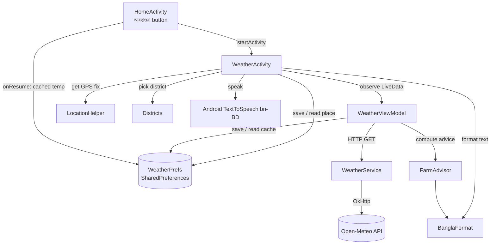
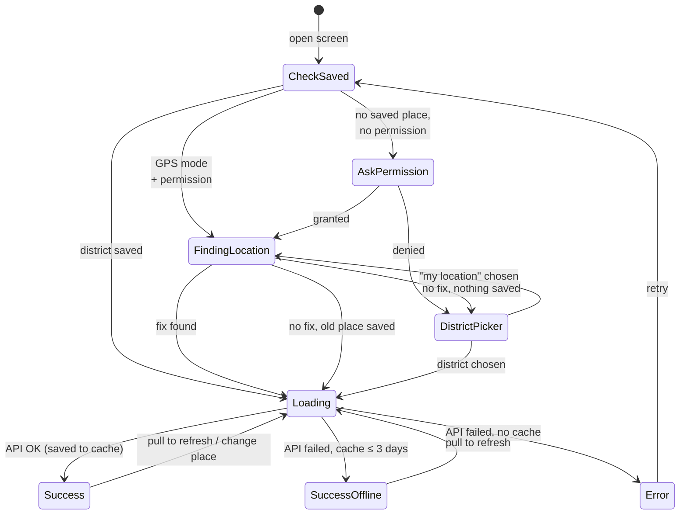
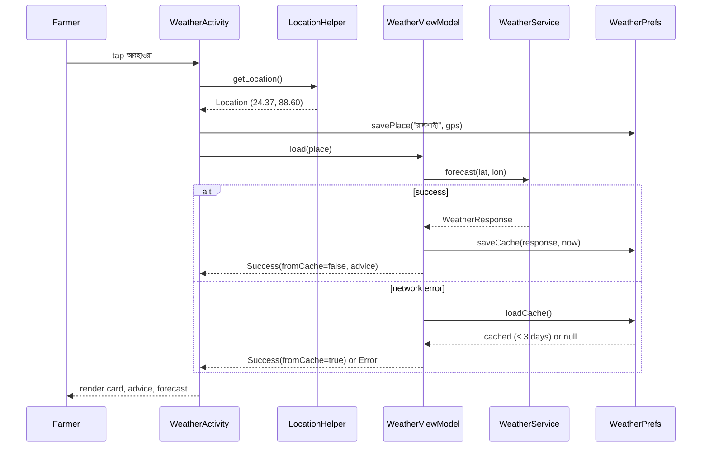

# 🌦️ Weather & Farming Advice — Feature Documentation

### আবহাওয়া ও পরামর্শ | Mango Disease Detector

| Item | Detail |
|------|--------|
| Feature | 7-day weather forecast + mango-specific farming advice |
| Target user | Mango farmers in Bangladesh (low-literacy friendly) |
| Language | Bengali (বাংলা): text, digits, day names, voice |
| Weather source | [Open-Meteo](https://open-meteo.com): free, no API key |
| Location | Coarse GPS, or manual pick from 64 districts |
| Offline | Last forecast cached, shown for up to 3 days |
| Branch | `feature/weather-advice` (commit `96623fe`) |

---

## 📑 Contents

1. [What the feature does](#-what-the-feature-does)
2. [Architecture](#-architecture)
3. [Screen-by-screen walkthrough](#-screen-by-screen-walkthrough)
4. [Location flow](#-location-flow)
5. [Data flow & API](#-data-flow--api)
6. [Farming advice engine](#-farming-advice-engine)
7. [Bengali formatting](#-bengali-formatting)
8. [Offline cache](#-offline-cache)
9. [Voice read-out](#-voice-read-out)
10. [File map](#-file-map)
11. [Testing](#-testing)
12. [Known limitations & future work](#-known-limitations--future-work)

---

## 🎯 What the feature does

A farmer taps **আবহাওয়া** on the home screen and sees:

- **Today's weather** for their district: temperature, condition, humidity, rain chance and wind.
- **Advice for mango farming** based on the next 24 hours and the current month. Examples: "don't spray today, rain will wash it off", "storm coming, tie weak branches", "anthracnose risk is high".
- **7-day forecast**: a scrollable strip of daily cards.
- **🔊 Voice**: one tap reads everything aloud in Bengali.

Design principles are the same as the rest of the app: big text, big icons, colour-coded cards, minimal reading needed.

---

## 🏗️ Architecture

The feature follows the app's existing **MVVM** pattern, with no new heavy libraries. It uses OkHttp + Gson, as `DetectorViewModel` does.



### Layers

| Layer | Class | Responsibility |
|-------|-------|----------------|
| UI | `ui/weather/WeatherActivity` | Permission, location, rendering, district picker, voice |
| UI | `ui/home/HomeActivity` | Weather button + cached temperature badge |
| ViewModel | `viewmodel/WeatherViewModel` | Loads forecast, falls back to cache, exposes `WeatherUiState` |
| Network | `network/WeatherService` | Builds Open-Meteo URL, parses JSON |
| Model | `model/WeatherResponse` | Gson data classes (`current`, `hourly`, `daily`) |
| Data | `data/WeatherPrefs` | Saved location + offline cache |
| Data | `data/Districts` | 64 districts with coordinates, nearest-district lookup |
| Logic | `utils/FarmAdvisor` | Rule-based mango farming advice (pure Kotlin, unit-tested) |
| Logic | `utils/BanglaFormat` | Bengali digits, day names, weather text/emoji, time labels |
| Platform | `utils/LocationHelper` | Coarse location via `LocationManager` (no Play Services) |

### UI state

```kotlin
sealed class WeatherUiState {
    data class Loading(val findingLocation: Boolean = false)
    data class Success(weather, placeName, updatedAt, fromCache, advice)
    object Error
}
```

The ViewModel survives screen rotation, so the forecast is **not** fetched again on rotation.

---

## 📱 Screen-by-screen walkthrough

### Screen 1: Home (updated)

A third large button was added below Gallery. After the first successful load, it also shows the cached weather icon and temperature.

```
┌──────────────────────────────┐
│            🍃                │
│      আমের রোগ নির্ণয়           │
│   পাতার ছবি তুলুন বা বেছে নিন      │
│                              │
│ ┌──────────────────────────┐ │
│ │   📷  ছবি তুলুন             │ │  ← existing (green)
│ └──────────────────────────┘ │
│ ┌──────────────────────────┐ │
│ │   🖼  গ্যালারি থেকে বেছে নিন   │ │  ← existing (outline)
│ └──────────────────────────┘ │
│ ┌──────────────────────────┐ │
│ │ ☀  আবহাওয়া · ☁️ ২৫°        │ │  ← NEW (outline, yellow sun)
│ └──────────────────────────┘ │
└──────────────────────────────┘
```

| Element | ID | Behaviour |
|---------|----|-----------|
| Weather button | `btnWeather` | Opens `WeatherActivity` with a slide animation |
| Temp badge | `tvHomeWeatherTemp` | Refreshed in `onResume()` from cache; hidden if no cache |

**Files:** `activity_home.xml`, `HomeActivity.kt`, `drawable/ic_weather.xml`

---

### Screen 2: Location permission (first launch only)

On the first open with no saved location, Android's system dialog asks for **approximate location**.

```
┌──────────────────────────────┐
│  Allow আমের রোগ নির্ণয় to access  │
│  this device's approximate   │
│  location?                   │
│                              │
│      While using the app     │ → GPS flow (Screen 3)
│      Only this time          │ → GPS flow (Screen 3)
│      Don't allow             │ → District picker (Screen 4)
└──────────────────────────────┘
```

- Only `ACCESS_COARSE_LOCATION` is requested. District-level accuracy is enough for weather, and it feels less invasive to farmers.
- If permission is denied, a toast "অনুমতি দেওয়া হয়নি" appears and the district picker opens.

---

### Screen 3: Finding location / Loading

```
┌──────────────────────────────┐
│ ←  আবহাওয়া ও পরামর্শ        (🔊) │
│                  [স্থান বদলান] │
│                              │
│             ◌                │
│   আপনার অবস্থান খোঁজা হচ্ছে…      │  ← while getting GPS (max 10 s)
│   আবহাওয়ার তথ্য আনা হচ্ছে…       │  ← while calling the API
└──────────────────────────────┘
```

| State | Text |
|-------|------|
| `Loading(findingLocation = true)` | আপনার অবস্থান খোঁজা হচ্ছে… |
| `Loading()` | আবহাওয়ার তথ্য আনা হচ্ছে… |

On **pull-to-refresh**, the old content stays visible and only the swipe spinner shows.

---

### Screen 4: District picker

Opens from the **স্থান বদলান** button, or automatically when permission is denied or GPS finds nothing.

```
┌──────────────────────────────┐
│  আপনার জেলা বেছে নিন              │
│                              │
│  📍 আমার বর্তমান অবস্থান          │ ← re-tries GPS
│  কক্সবাজার                     │
│  কিশোরগঞ্জ                     │
│  কুড়িগ্রাম                      │
│  …  (all 64, Bengali order)  │
│                       বাতিল  │
└──────────────────────────────┘
```

- The list is sorted with a Bengali `Collator`.
- Choosing a district saves it (`isGps = false`) and loads its forecast.
- **বাতিল (Cancel)** closes the dialog. If no location was ever chosen, it also closes the screen, because there is nothing to show.
- If no location is saved yet, the dialog cannot be dismissed by tapping outside it.

---

### Screen 5: Weather (main content)

```
┌──────────────────────────────┐
│ ←  আবহাওয়া ও পরামর্শ        (🔊) │  ← header + voice button
│ 📍 ঢাকা           [স্থান বদলান] │  ← location row
│                              │
│ ⚠️ ইন্টারনেট নেই — আগের তথ্য…    │  ← only when showing cache
│ ╔══════════════════════════╗ │
│ ║ ২৫°                  ☁️   ║ │  ← green gradient card
│ ║ আংশিক মেঘলা                ║ │
│ ║ অনুভূত ২৯°                  ║ │
│ ║ সর্বোচ্চ ৩০° · সর্বনিম্ন ২৪°    ║ │
│ ║ ┌──────┐┌──────┐┌───────┐ ║ │
│ ║ │ 💧   ││ 🌧️   ││ 💨     │ ║ │
│ ║ │ ৮১%  ││ ০%   ││৭ কিমি/ঘ│ ║ │
│ ║ │আর্দ্রতা││ বৃষ্টি ││ বাতাস  │ ║ │
│ ║ └──────┘└──────┘└───────┘ ║ │
│ ╚══════════════════════════╝ │
│        সর্বশেষ আপডেট: আজ রাত ১০:০৯ │
│                              │
│ 🌾 আম চাষির জন্য পরামর্শ           │
│ ┌──────────────────────────┐ │
│ │ ✅ আবহাওয়া ভালো। প্রয়োজন হলে  │ │  ← GOOD (green)
│ │    আজ স্প্রে করার জন্য উপযুক্ত দিন। │ │
│ └──────────────────────────┘ │
│ ┌──────────────────────────┐ │
│ │ 🌱 সার দেওয়ার সময়। …        │ │  ← INFO (blue, seasonal)
│ └──────────────────────────┘ │
│                              │
│ 🌦️ ৭ দিনের পূর্বাভাস              │
│ ┌─────┐┌────────┐┌─────┐ →   │  ← horizontal scroll
│ │ আজ  ││আগামীকাল ││ শুক্র │      │
│ │ ☁️  ││  ☁️     ││ ☁️  │      │
│ │ ৩০° ││  ২৯°    ││ ৩১° │ (red: max)
│ │ ২৪° ││  ২৩°    ││ ২৩° │ (blue: min)
│ │☔১৪%││ ☔০%    ││☔২% │      │
│ └─────┘└────────┘└─────┘      │
│                              │
│   আবহাওয়ার তথ্যসূত্র: Open-Meteo.com │  ← required attribution
└──────────────────────────────┘
```

#### Sections

| # | Section | Views | Data source |
|---|---------|-------|-------------|
| 1 | Header | `btnBack`, `btnSpeak` | — |
| 2 | Location | `tvLocation`, `btnChangeLocation` | `SavedPlace.name` |
| 3 | Offline banner | `tvOffline` | `Success.fromCache` |
| 4 | Current card | `tvTemperature`, `tvCondition`, `tvWeatherEmoji`, `tvFeelsLike`, `tvMaxMin` | `current.*`, `daily[today]` |
| 5 | Stat tiles | `tvHumidity`, `tvRainChance`, `tvWind` | `current.humidity`, **max rain chance over the next 24 h**, `current.windSpeed` |
| 6 | Last update | `tvUpdated` | `Success.updatedAt` |
| 7 | Advice | `layoutAdvice` ← `item_advice.xml` × N | `FarmAdvisor.advise()` |
| 8 | Forecast | `layoutForecast` ← `item_forecast_day.xml` × 7 | `daily[today..]` |
| 9 | Attribution | static text | Open-Meteo licence (CC BY 4.0) |

#### Advice card colours

| Level | Colour | Background | Meaning |
|-------|--------|-----------|---------|
| `DANGER` | 🔴 `#C62828` | `#FFEBEE` | Act now: storm, heavy rain, disease risk |
| `CAUTION` | 🟠 `#EF8F00` | `#FFF8E1` | Be careful: don't spray, heat, mildew risk |
| `GOOD` | 🟢 `#2E7D32` | `#E8F5E9` | Good day for work |
| `INFO` | 🔵 `#1565C0` | `#E3F2FD` | Seasonal mango-stage tip |

The cards are sorted **DANGER → CAUTION → GOOD → INFO**, so the most urgent card is always on top.

#### Interactions

| Action | Result |
|--------|--------|
| Pull down | Refreshes location (if GPS mode) and forecast |
| স্থান বদলান | Opens the district picker (Screen 4) |
| 🔊 | Reads the weather and all advice aloud in Bengali |
| ← | Back to home |

---

### Screen 6: Error

Shown only when the network fails **and** there is no usable cache.

```
┌──────────────────────────────┐
│ ←  আবহাওয়া ও পরামর্শ        (🔊) │
│                              │
│             📡               │
│  আবহাওয়ার তথ্য আনা যায়নি। ইন্টারনেট │
│  সংযোগ দেখে আবার চেষ্টা করুন।       │
│ ┌──────────────────────────┐ │
│ │      আবার চেষ্টা করুন         │ │  → retries the whole load
│ └──────────────────────────┘ │
└──────────────────────────────┘
```

---

### State diagram



---

## 📍 Location flow

**File:** `utils/LocationHelper.kt`

This uses the platform `LocationManager`, so it works on phones **without Google Play Services**.

```
getLocation()
 ├─ no permission? ──────────────────────────► null
 ├─ last known fix < 30 min old? ────────────► return it
 ├─ ask ALL enabled providers at once:
 │     network  (all versions)
 │     fused    (Android 12+)
 │     gps      (Android 12+, coarsened by OS)
 │   first non-null fix wins, others cancelled
 ├─ 10 s timeout ───────────────────────────► fall back to last known (any age)
 └─ nothing ───────────────────────────────► null → district picker
```

**Why race the providers?** During testing on the Pixel 7 emulator, the network provider was "enabled" but never returned a fix. Asking only one provider meant a 10 s wait and then failure. Asking all of them at once fixed it.

| API level | Method |
|-----------|--------|
| 30+ | `LocationManager.getCurrentLocation()` with `CancellationSignal` |
| 24–29 | `requestSingleUpdate()` (deprecated but correct on old phones) |

**GPS → name:** `Districts.placeName(lat, lon)` returns the nearest district headquarters (by a cos-latitude-corrected distance). If the point is outside Bangladesh's bounding box (lat 20.5–26.7, lon 88.0–92.7), it shows **"আমার অবস্থান"** instead.

---

## 🌐 Data flow & API

**File:** `network/WeatherService.kt`

### Request

```
GET https://api.open-meteo.com/v1/forecast
    ?latitude=24.3745&longitude=88.6042
    &current=temperature_2m,relative_humidity_2m,apparent_temperature,
             weather_code,wind_speed_10m,wind_gusts_10m,is_day
    &hourly=temperature_2m,relative_humidity_2m,precipitation_probability,
            precipitation,wind_gusts_10m
    &daily=weather_code,temperature_2m_max,temperature_2m_min,
           precipitation_probability_max,precipitation_sum,wind_gusts_10m_max
    &timezone=Asia/Dhaka
    &forecast_days=7
```

- No API key is needed. The free tier is for non-commercial use, and attribution is shown on screen.
- Units: °C, km/h, mm (Open-Meteo defaults).
- The shared `ApiClient.client` is reused (30 s connect / 60 s read timeout).

### Response → model

| JSON | Kotlin (`WeatherResponse.kt`) | Used for |
|------|-------------------------------|----------|
| `current.temperature_2m` | `CurrentWeather.temperature` | Big temperature |
| `current.relative_humidity_2m` | `.humidity` | 💧 tile |
| `current.apparent_temperature` | `.feelsLike` | "অনুভূত" |
| `current.weather_code` | `.weatherCode` | Condition text + emoji |
| `current.wind_speed_10m` | `.windSpeed` | 💨 tile |
| `current.wind_gusts_10m` | `.windGusts` | Storm rule |
| `current.is_day` | `.isDay` | ☀️ vs 🌙 |
| `hourly.*` (168 slots) | `HourlyWeather` | Next-24h window for advice |
| `daily.*` (7 days) | `DailyWeather` | Forecast strip, today's max/min |

All list fields are `List<Double?>`, because Open-Meteo can return `null` entries.

### Load sequence



---

## 🌾 Farming advice engine

**File:** `utils/FarmAdvisor.kt` (pure Kotlin, no Android dependencies)

### Inputs

`FarmAdvisor.next24h()` looks at the **24 hourly slots starting at the current hour** (matched against `current.time`, in Dhaka time):

| Value | How |
|-------|-----|
| `maxRainChance` | max of `precipitation_probability` |
| `rainSum` | sum of `precipitation` (mm) |
| `avgHumidity` | mean of `relative_humidity_2m` |
| `avgTemp` | mean of `temperature_2m` |
| `maxGust` | max of hourly gusts and the current gust |

It also uses **today's max/min**, the **rain sum for the next 3 days**, and the **month** (1–12).

### Rules

| # | Rule | Condition | Level | Advice (Bengali) |
|---|------|-----------|-------|------------------|
| 1 | Storm | `maxGust ≥ 60 km/h` | 🔴 DANGER | কালবৈশাখী (Mar–May) / ঝড়ো বাতাসের আশঙ্কা! … দুর্বল ডাল খুঁটি দিয়ে বেঁধে দিন |
| 1b | Windy | `40 ≤ maxGust < 60` | 🟠 CAUTION | জোরে বাতাস … আজ স্প্রে করবেন না |
| 2 | Heavy rain | `rainSum ≥ 50 mm` | 🔴 DANGER | বাগানের নালা পরিষ্কার রাখুন, গোড়ায় পানি জমতে দেবেন না |
| 3 | Spray window | `maxRainChance ≥ 60%` | 🟠 CAUTION | ছত্রাকনাশক বা কীটনাশক স্প্রে করবেন না, বৃষ্টিতে ধুয়ে যাবে |
| 4 | Anthracnose | `avgHumidity ≥ 80%` **and** `20 ≤ avgTemp ≤ 32°C` **and** wet (`rainChance ≥ 50%` or `rainSum ≥ 2 mm`) | 🔴 DANGER | অ্যানথ্রাকনোজ রোগের ঝুঁকি বেশি … ম্যানকোজেব বা কার্বেন্ডাজিম স্প্রে করুন |
| 5 | Powdery mildew | month Jan–Mar **and** `avgHumidity ≥ 60%` **and** `10 ≤ todayMin ≤ 20°C` | 🟠 CAUTION | পাউডারি মিলডিউ রোগের ঝুঁকি … মুকুলে সালফার স্প্রে করুন |
| 6 | Heat stress | `todayMax ≥ 36°C` **and** next 3 days rain `< 2 mm` | 🟠 CAUTION | তীব্র গরম … বিকেলে গোড়ায় পানি দিন, গুটি ঝরা কমবে |
| 7 | Good day | none of the above **and** `rainChance < 30%` **and** `gust < 30` | 🟢 GOOD | আবহাওয়া ভালো … স্প্রে (May–Jul: আম পাড়া) করার উপযুক্ত দিন |
| 7b | Normal | none of the above, but not calm enough for 7 | 🟢 GOOD | আবহাওয়া স্বাভাবিক। নিয়মিত পরিচর্যা চালিয়ে যান |
| 8 | Seasonal tip | always | 🔵 INFO | see the table below |

The thresholds are `const val`s at the top of `FarmAdvisor` (`STORM_GUST_KMH`, `WINDY_GUST_KMH`, `HEAVY_RAIN_MM`, `NO_SPRAY_RAIN_CHANCE`, `HEAT_C`), so they are easy to tune.

### Seasonal mango calendar (Bangladesh)

| Months | Stage | Tip |
|--------|-------|-----|
| Dec–Jan | Before flowering | 🌸 Don't irrigate now, it helps flowering (মুকুল) |
| Feb–Mar | Flowering / fruit set | 🌼 Watch for hopper insects & powdery mildew |
| Apr–May | Fruit growth | 🥭 Irrigate every 15 days to reduce fruit drop |
| Jun–Jul | Ripening / harvest | 🧺 Harvest on dry days, in the morning |
| Aug–Sep | Post-harvest | ✂️ Prune dead, diseased and crowded branches |
| Oct–Nov | Fertilising | 🌱 Apply fertiliser around the base, light irrigation |

> ⚠️ The rules are practical heuristics based on common Bangladeshi mango-growing guidance (BARI-style recommendations). They are not a validated agronomic model. An agriculture expert should review them before real-world use.

---

## 🔤 Bengali formatting

**File:** `utils/BanglaFormat.kt`

| Function | Example in | Example out |
|----------|-----------|-------------|
| `digits()` | `2026-11-04` | `২০২৬-১১-০৪` |
| `temp()` | `27.6` | `২৮°` |
| `number()` | `81.0` | `৮১` |
| `dayLabel(date, 0)` | today | `আজ` |
| `dayLabel(date, 1)` | tomorrow | `আগামীকাল` |
| `dayLabel("2026-11-06", 2)` | Friday | `শুক্র` |
| `updatedAt()` | 15:05 today | `আজ বিকেল ৩:০৫` |

**Time of day labels:** সকাল (4–11), দুপুর (12–14), বিকেল (15–17), সন্ধ্যা (18–19), রাত (20–3).

### Weather codes (WMO → Bengali)

| Code | Bengali | Emoji |
|------|---------|-------|
| 0 | পরিষ্কার আকাশ | ☀️ / 🌙 |
| 1, 2 | আংশিক মেঘলা | ⛅ |
| 3 | মেঘলা আকাশ | ☁️ |
| 45, 48 | কুয়াশা | 🌫️ |
| 51–57 | গুঁড়ি গুঁড়ি বৃষ্টি | 🌦️ |
| 61, 66, 80 | হালকা বৃষ্টি | 🌦️ |
| 63, 81 | বৃষ্টি | 🌧️ |
| 65, 67, 82 | ভারী বৃষ্টি | 🌧️ / ⛈️ |
| 95 | বজ্রসহ বৃষ্টি | ⛈️ |
| 96, 99 | শিলাবৃষ্টি ও ঝড় | ⛈️ |

---

## 💾 Offline cache

**File:** `data/WeatherPrefs.kt`. SharedPreferences file: `weather_prefs`.

| Key | Content |
|-----|---------|
| `place_name`, `place_lat`, `place_lon`, `place_is_gps` | Last chosen location |
| `weather_cache` | JSON of `CachedWeather(response, placeName, savedAt)` |

- The cache is written after **every** successful fetch.
- It is read when the fetch fails, and by the home screen badge.
- A cache **older than 3 days is ignored**, so old advice is never shown.
- When the cache is shown, the orange banner "⚠️ ইন্টারনেট নেই — আগের তথ্য দেখানো হচ্ছে" and the real update time make it clear.

---

## 🔊 Voice read-out

The voice button uses the same approach as `ResultActivity`: `TextToSpeech` with `Locale("bn", "BD")`.

Spoken text:

```
{জেলা}। আজকের আবহাওয়া {অবস্থা}। তাপমাত্রা {২৫} ডিগ্রি।
বাতাসের আর্দ্রতা {৮১} শতাংশ। বৃষ্টির সম্ভাবনা {০} শতাংশ।
পরামর্শ। {all advice texts…}
```

Before speaking, symbols are replaced: `%` → "শতাংশ", `°` → "ডিগ্রি", and brackets become pauses. If the Bengali voice isn't installed, a toast shows "ভয়েস সাপোর্ট প্রস্তুত নয়".

---

## 🗂️ File map

### New files

```
app/src/main/java/com/example/mango_disease_detector/
├── data/
│   ├── Districts.kt            # 64 districts, nearest lookup, BD bounds check
│   └── WeatherPrefs.kt         # SavedPlace + CachedWeather persistence
├── model/
│   └── WeatherResponse.kt      # Gson models: Current/Hourly/Daily
├── network/
│   └── WeatherService.kt       # Open-Meteo request + parse
├── ui/weather/
│   └── WeatherActivity.kt      # Screen, permission, picker, render, TTS
├── utils/
│   ├── BanglaFormat.kt         # Digits, days, weather text/emoji, time
│   ├── FarmAdvisor.kt          # Advice rules + seasonal tips
│   └── LocationHelper.kt       # Coarse location, providers raced
└── viewmodel/
    └── WeatherViewModel.kt     # WeatherUiState, network → cache fallback

app/src/main/res/
├── drawable/
│   ├── bg_weather_card.xml     # Green gradient, 24dp radius
│   ├── bg_weather_stat.xml     # Translucent white tile
│   ├── bg_forecast_today.xml   # Highlighted "today" card
│   └── ic_weather.xml          # Sun icon for home button
└── layout/
    ├── activity_weather.xml    # SwipeRefresh > ScrollView > sections
    ├── item_advice.xml         # Emoji + text, colour set in code
    └── item_forecast_day.xml   # Day, emoji, max, min, rain %

app/src/test/java/com/example/mango_disease_detector/
├── FarmAdvisorTest.kt          # 11 tests
└── BanglaFormatTest.kt         # 7 tests (incl. Districts)
```

### Changed files

| File | Change |
|------|--------|
| `AndroidManifest.xml` | `ACCESS_COARSE_LOCATION`, `android.hardware.location` (not required), `WeatherActivity` |
| `activity_home.xml` | `btnWeather` + `tvHomeWeatherTemp` |
| `HomeActivity.kt` | Click → `WeatherActivity`; `onResume()` shows cached temp |
| `strings.xml` | 21 `weather_*` strings + `btn_weather`, `btn_cancel`, `btn_back` |
| `colors.xml` | Weather card gradient + 8 advice colours |
| `libs.versions.toml`, `app/build.gradle.kts` | `androidx.swiperefreshlayout:swiperefreshlayout:1.1.0` |

The only new dependency is **swiperefreshlayout**. Coroutines and `lifecycleScope` come from existing lifecycle libraries.

---

## ✅ Testing

### Unit tests

```bash
./gradlew :app:testDebugUnitTest
```

| Test class | Covers |
|------------|--------|
| `FarmAdvisorTest` | 24h window start, calm day → GOOD, rain → no spray, Kalbaishakhi storm, anthracnose wet/dry, heavy rain drainage, powdery mildew in Feb, heat → irrigate, severity sort order, today index |
| `BanglaFormatTest` | Bengali digits, temp rounding, আজ/আগামীকাল/weekday, time-of-day label, 64 districts, nearest district, outside-BD → null |

Result at commit: **19/19 passing** (including the existing `ExampleUnitTest`).

### Manual testing done

| Device | Result |
|--------|--------|
| Realme RMX3630 (real phone) | ✅ Permission dialog → GPS → **ঢাকা** → live forecast, advice, 7-day strip, home badge |
| Pixel 7 API 34 emulator | ✅ Fallback to district picker when no fix. ⚠️ Not re-tested after the provider-race fix |

### Emulator tips

```bash
# Set location to Rajshahi
adb emu geo fix 88.6042 24.3745

# Grant permission without the dialog
adb shell pm grant com.example.mango_disease_detector android.permission.ACCESS_COARSE_LOCATION

# Reset saved location / cache
adb shell pm clear com.example.mango_disease_detector
```

---

## 🚧 Known limitations & future work

| Item | Notes |
|------|-------|
| Voice not verified | The TTS read-out wasn't heard during testing. It needs the Bengali voice data installed |
| Status bar in dark mode | White icons on the light background in system dark mode. This affects the **whole app** and existed before this feature |
| Picker dialog in dark mode | The district dialog follows the system dark theme while the app content is light |
| Advice rules | Heuristics. They should be reviewed by an agronomist (e.g. a BARI / DAE extension officer) |
| No storm notifications | Possible next step: a daily `WorkManager` job that alerts when rule 1 or 2 fires |
| No official BMD data | The Bangladesh Meteorological Department has no clean public API. Open-Meteo is used instead |
| Commercial use | Open-Meteo's free tier is for non-commercial use. A paid plan is needed if the app is commercialised |
